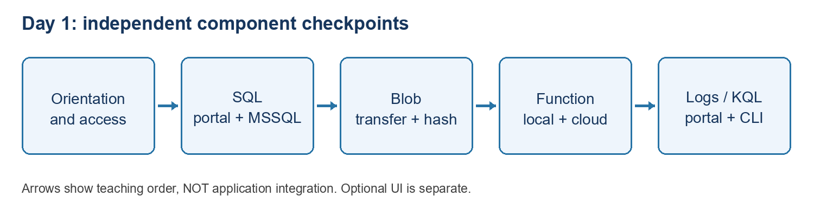

CORE ATTENDEE EDITION: Start with 00_START_HERE.md at the pack root. Only the core two-day route is supplied. Optional publishing, dummy website, resource creation, identity/networking and advanced Azure tracker extensions mentioned below are not assigned or included. Use your own extracted path where a command shows C:\YOUR-ATTENDEE-PACK. Do not copy instructor settings.

Day 1 - individual component exercises

09:45-10:00 setup verification: confirm route, assigned access, files and previously installed tools; no classroom installs. This is inside the existing opening block. See 02_Pre_Course_Setup_And_Prerequisites_Guide.md in the attendee-pack root.

# Confirmed delivery window - 09:45-17:30

The opening includes a 15-minute guided portal walkthrough before individual practice. SQL and Blob include short paired cost decisions: state the workload assumption, cost driver, safe recommendation and risk. Day 2 has a mandatory deeper Cost Management lab. Use existing assigned resources; optional creation guides are not required.

| Start | Finish | Block                                                    |
|-------|--------|----------------------------------------------------------|
| 09:45 | 11:05  | Welcome, introductions, foundations and orientation      |
| 11:05 | 12:20  | SQL including cost decision                              |
| 12:20 | 12:35  | Break                                                    |
| 12:35 | 13:40  | Blob including cost decision                             |
| 13:40 | 14:25  | Lunch                                                    |
| 14:25 | 15:40  | Function                                                 |
| 15:40 | 15:55  | Break                                                    |
| 15:55 | 16:50  | Logs/KQL                                                 |
| 16:50 | 17:30  | Troubleshooting, knowledge check, cost recap and cleanup |

# Follow this order

1\. Orientation: Basic_Lab_VS_Code_Azure_Function_And_Dummy_Tracker.md, orientation-only route, Parts 1-2. Do not require Function tools for discovery.

2\. SQL: Basic_Lab_01_Azure_SQL_Portal_And_VS_Code.md. Prepare access, create/read rows, add Notes, update and verify in portal and MSSQL.

3\. Blob: Basic_Lab_02_Blob_Storage_Portal_And_VS_Code.md. Private container, network/IAM, portal and terminal transfers, then hash comparison.

4\. Function: return to the Function guide, Parts 3-5 and relevant Part 8 evidence/cleanup. Do not deploy to another attendee's host.

5\. Logs/KQL: Basic_Lab_03_Log_Analytics_Portal_And_VS_Code.md. Same synthetic query in portal and terminal; this does not prove telemetry ingestion.

6\. Optional local UI: Function guide Parts 6-8, only if assigned.

# Where are the project files?

From the attendee-pack root open Labs\PortalAndVsCodeBasics for SQL/Blob/Logs; open Labs\VsCodePublishBasics\HelloAzureFunction for the Function.

Optional - Portal Resource Creation contains additional creation exercises, not a requirement to create duplicate Azure resources. Owner approval is needed.

Record each result as Passed, Blocked or Not run. Keep passwords, tokens and real document content out of screenshots.

# Day 1 tested walkthrough - attendee support

Updated 28 October 2026. Use this illustrated support section alongside the numbered lab; do not skip approval gates.

## 1. Follow the course route; these are separate exercises

Diagram: day1 route

Use fictional training data only. Orientation, SQL, Blob Storage, the HTTP Function and Logs/KQL are independent checkpoints. They do not form a connected document-processing application. The local dummy UI is optional.

## Find the correct folder without losing your chat

Use the supplied attendee-pack location, not a path copied from the instructor's laptop. SQL, Blob and Logs use Labs\PortalAndVsCodeBasics; the Function uses Labs\VsCodePublishBasics\HelloAzureFunction. Quote paths containing spaces. In an existing terminal, Set-Location changes the terminal folder only. It does not change Explorer's workspace.

Set-Location "C:\YOUR-ATTENDEE-PACK\Labs\PortalAndVsCodeBasics"\
Get-Location\
Test-Path .\Samples\Logs\01-fictional-status.kql

Replace C:\YOUR-ATTENDEE-PACK before running. Test-Path should be True. File \> Open Folder may change the window's workspace; code --new-window opens another window and the earlier chat may remain in the original one. Use chat history or the original window to return; do not repeat completed cloud changes just because a new conversation appeared.

## Sign-in and permissions are separate

Portal sign-in, VS Code Azure Resources, MSSQL and Azure CLI have separate sign-in contexts. Confirm the approved tenant, subscription and target. Azure Reader shows resources but does not automatically grant SQL queries, Blob transfers, Function key access or publishing rights.

az account show --query "{name:name,id:id,tenant:tenantId}" -o table

If CLI sign-in is missing, use az login with your approved account. Do not paste tokens, passwords, keys, connection strings or key-bearing URLs into chat or evidence. Never broaden network or role permissions to work around an unexplained error.

## 6. Finish safely and record your own evidence

Record Passed, Blocked or Not run separately for each item: resource discovery; SQL portal connect/create/read; SQL MSSQL read/alter/update; portal recheck; Blob transfer and hashes in both directions; local Function build/invocation; publishing approval/result or test-only; cloud keyed response and keyless rejection; portal/terminal KQL match.

Capture the target, time, command and expected/actual non-secret output. An instructor screenshot is an example, not your pass. SQL rows and schema do not prove which tool wrote them. A green deployment is not an invocation. A reported key rotation is not independent proof the exposed key was invalidated.

Record your own results. Prior instructor rehearsal results do not count as your evidence.

Stop your own local Function with Ctrl+C. Close Azurite only if you started it and no other work needs it. Disconnect the SQL client and sign out on shared machines. Local shutdown does not stop cloud billing. Do not delete shared resources or restore network/role changes without owner approval; temporary permission cleanup requires checking dependencies and verifying the narrower approved access first.

Day 1 is complete when required checks have your evidence or explicit approved exceptions. Record blocked steps honestly before continuing to Day 2.
