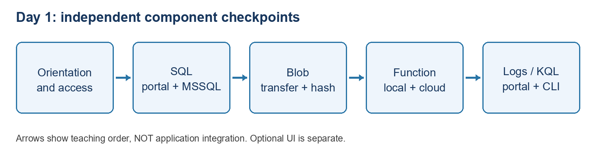

CORE ATTENDEE EDITION: Start with 00_START_HERE.md at the pack root. Only the core two-day route is supplied. Optional publishing, dummy website, resource creation, identity/networking and advanced Azure tracker extensions mentioned below are not assigned or included. Use your own extracted path where a command shows C:\YOUR-ATTENDEE-PACK. Do not copy instructor settings.

# Start here - standalone component exercises before integration

Updated 28 October 2026. Windows and PowerShell. Use fictional data only.

## Learning path

**Phase A: learn each component separately.** Complete one small exercise, verify it in the portal and VS Code where supported, and record the result before moving on. These exercises do not call each other.

**Phase B: small standalone applications later.** After the direct-access exercises, build, run, deploy and test one small application per service. Each application should demonstrate only its assigned service, not combine SQL, Blob, messaging and telemetry into a document-processing workflow. This is the next stage, not part of today’s direct-access exercises.

**Phase C: combine everything last.** After the individual application checkpoints pass, introduce a separately approved document-tracker integration. Do not add SQL, Blob or messaging connections to the Function during Phase A.

The local dummy tracker is an optional UI exercise, NOT the integrated system. Its fixed records do not prove that SQL, Blob or a Function are connected.

## Phase A - follow this order

| **Order** | **Lab** | **Portal activity** | **VS Code activity** | **Time** |
|----|----|----|----|----|
| 1 | Orientation and existing-resource access only | Sign in; identify directory, subscription and assigned resources | Open the supplied folders; sign in; inspect the same resources | 15-25 min |
| 2 | Azure SQL Database | Create table/rows; verify changes | Connect with MSSQL; SELECT, add column, UPDATE | 45-60 min |
| 3 | Azure Blob Storage | Create private attendee container; upload/download | Inspect account; upload/download with Entra CLI | 40-50 min |
| 4 | Standalone HTTP Azure Function | Inspect approved host; test the deployed Function | Run, publish with approval, and test fixed JSON response | 45-60 min |
| 5 | Standalone Log Analytics query | Select workspace; run synthetic KQL | Save a query; run it against that workspace from terminal | 35-45 min |
| 6 optional | Local dummy tracker UI | None; do not deploy in this exercise | Start local website; check three fixed records and detail buttons | 20-30 min |

Times exclude software installation and access preparation; allow an extra 15-25 minutes where firewall/role preparation is required.

### Exactly which guide to open

1.  **Orientation:** open [the Function and tracker guide](Basic_Lab_VS_Code_Azure_Function_And_Dummy_Tracker.md), complete **Parts 1 and 2 only**, following its orientation-only prerequisite note (defer .NET/Core Tools/Azurite until the Function exercise), then stop before Part 3. Do not start or publish either application yet. Inspect assigned resources without editing.
2.  **SQL:** open [the SQL guide](Basic_Lab_01_Azure_SQL_Portal_And_VS_Code.md). Follow sections **1 -\> 2 -\> 2A -\> 3 -\> 4 -\> 5 -\> 6 -\> 7 -\> remaining verification/cleanup sections**. Section 2A is instructor-approved access preparation, not permission for attendees to change shared networking.
3.  **Storage:** open [the Blob guide](Basic_Lab_02_Blob_Storage_Portal_And_VS_Code.md). Follow sections **1 -\> 1A -\> 1B -\> 2 through 8**. Sections 1A/1B explain network and identity preparation; authorised operators make those changes.
4.  **Function:** return to [the Function and tracker guide](Basic_Lab_VS_Code_Azure_Function_And_Dummy_Tracker.md). Check its prerequisites, complete **Parts 3, 4 and 5**, then complete the Function-related evidence and cleanup in **Part 8**. Mark website results Not run. Skip Parts 6/7 and the optional website-publishing appendix. If publishing is not approved, skip Part 4 and test only the approved instructor Function in Part 5.
5.  **Logs:** open [the Log Analytics guide](Basic_Lab_03_Log_Analytics_Portal_And_VS_Code.md) and complete its main synthetic-query path. Real Function telemetry is optional and is not required for this independent exercise.
6.  **Optional local UI:** only if the instructor includes it, return to the Function/tracker guide, complete **Parts 6, 7 and the website-related evidence/cleanup in Part 8**. Do not use the website deployment appendix.

The SQL, Storage and Logs filenames retain their existing prefixes so links and sample paths keep working. Their titles and this index specify course order; the filename prefix alone is not the complete timetable.

## Component checkpoints - stop and verify each one

| **Exercise** | **Needed before starting** | **Evidence to record** | **Not part of this exercise** |
|----|----|----|----|
| 1 Orientation | Approved sign-in, VS Code and supplied folders | Correct tenant/subscription; same assigned resources found in portal and VS Code | Provisioning or deploying anything |
| 2 SQL | Authorised database identity, approved network, unique table suffix | Connection SELECT; two rows; Notes column and update verified in both tools | Calling SQL from an application |
| 3 Storage | Approved network, management read access and container data role | Private container; uploads visible in both tools; matching download hashes | Function bindings, processing or public blob URLs |
| 4 Function | .NET/Core Tools prerequisites and approved Function host/runtime | Local response; authorised cloud response; portal test; keyless request rejected | SQL/Blob/Service Bus code or website deployment |
| 5 Logs | Existing workspace and query permission | Same three synthetic rows and columns in portal and terminal | Enabling ingestion or claiming synthetic rows are live telemetry |
| 6 Optional UI | .NET prerequisite and supplied local website | Three fixed records and working detail buttons | Real uploads, database/API calls or document processing |

These are a teaching order, not technical dependencies: for example, the standalone Function does not need the SQL table or Blob container. If access blocks a component, mark it **Blocked**, record the exact failed step, and continue with another independent component only if the instructor directs. Do not mark an unexecuted portal/VS Code check Passed.

## Phase B - standalone application exercises later

The next stage uses the service access learned in Phase A. It needs separate application instructions, approved identities, hosting targets and deployment permissions. The following are teaching objectives, not completed projects:

| **Service** | **Later single-service application objective** | **Verification** |
|----|----|----|
| SQL | Small app that adds and reads fictional rows in its own assigned table | Local and approved hosted app show the same database rows |
| Blob Storage | Small app that uploads and lists fictional files in its own private container | Local and approved hosted app operations match portal blob evidence |
| Azure Function | Small standalone HTTP application; extend the existing fixed-response exercise only within its approved scope | Local/cloud responses and error cases match |
| Log Analytics / KQL | Small authenticated query client that reads an assigned workspace | Its bounded query result matches the portal; no workspace keys embedded |

Log Analytics is the service; KQL is its query language, not a second resource to deploy. Application Insights instrumentation, Service Bus or other services need their own agreed exercise scope before being included. Do not assume a query client is the same as an application that emits telemetry.

No new applications or hosting resources are created by this course index. The existing dummy tracker remains fixed-data UI practice only.

## Phase C - integration readiness gate

Before any integrated document-tracker exercise, the instructor confirms:

- Each required component’s local/cloud access and verification has passed.
- Attendee targets, table/container names, identity permissions and network paths are explicitly assigned; no shared instructor credentials are used.
- The integrated architecture and data flow are explained separately.
- Application identities, configuration, deployment targets, costs and permission to change resources are reviewed before integration starts.
- An end-to-end test and cleanup plan is supplied for that integrated system.

**Stop here for component training.** This pack does not provide a completed end-to-end integration lab. Do not assume the existing dummy website or fixed-response Function already integrates services. Service Bus or other components need their own standalone exercise if the integrated design uses them; they are not silently included in these five component exercises.

**Main idea:** the portal and VS Code operate on the SAME cloud resource. VS Code is not a second database/storage account/workspace. Running a command on your laptop may still read or change Azure data.

## What to execute in VS Code now - Phase A only

Open the relevant supplied folder with **File \> Open Folder**. Complete that service’s access preparation before executing anything. For terminal commands use **Terminal \> New Terminal \> PowerShell**; for SQL use the MSSQL query editor. Do not run dotnet build for a .sql, .txt or .kql file.

| **Component** | **Action now** | **Where it runs** | **How to verify** |
|----|----|----|----|
| SQL | Open the supplied SQL scripts; connect to the assigned database using MSSQL; Execute Query | Azure SQL executes the statements | Run SELECT in both MSSQL and portal Query editor |
| Blob | Use the supplied Azure CLI commands with –auth-mode login | CLI uploads/downloads against the existing storage account | List in terminal and portal; compare download hashes |
| Function | Follow the separate Function guide: run locally, build/publish to the approved Function App | First local Functions host, then Azure Functions | Test local endpoint and cloud Function, including portal Test/Run |
| Logs/KQL | Run the supplied Invoke-LabQuery.ps1 with the assigned Workspace ID | Azure Monitor executes the KQL | Compare the three expected rows with portal Logs |

For SQL: the instructor verification script reads the retained instructor table only; use attendee scripts and your assigned suffix to practise changes. For Blob: upload fictional sample files only to your assigned container. For Logs: saving a KQL file does not run it, and synthetic rows do not prove application telemetry is being collected.

### What “publish” means in each lab

- Function / website: build and deploy executable application files.
- SQL: execute an approved SQL script against a database; no Web App publishing.
- Blob: upload a file to a private container; not enable public website hosting.
- Log Analytics: submit a read-only query; saving a local KQL file does not ingest logs or deploy anything.

## Before the session: instructor checklist

- Assign account, tenant, subscription, resource group and a unique attendee ID such as `ab01`. Do not let attendees overwrite shared targets.
- Install VS Code, Azure Resources and MSSQL extensions. Storage extension is optional; the Entra CLI path is the reproducible data-access route.
- Azure CLI must be available for storage/log queries; confirm `az version`, approved sign-in and subscription. No keys or connection strings required.
- SQL needs BOTH an authorised database user/permissions AND an approved network path. Read SQL section 2A for the first-time IP/firewall walkthrough. Your own current public IP requires approval; another person's firewall rule does not automatically admit your laptop.
- For SQL allocate a disposable database or approved per-attendee table name plus CREATE TABLE and ALTER-on-schema permission, or use the read-only route. Supply a least-privilege training login privately if Entra is unavailable.
- For storage provide management Reader plus Storage Blob Data Contributor at the attendee container. Precreate the container for container-scoped roles; creating a container requires suitable permission on the account. Avoid host/deployment containers in Function storage accounts. Storage sections 1A and 1B explain IP rules, IAM assignment, Save/verify steps and removal of temporary rules. Allow 15-25 extra minutes for setup.
- For Log Analytics provide workspace query access (for example Log Analytics Reader) and correct workspace name, resource group and Workspace ID GUID. A linked workspace can be outside Training. No ADX cluster is required.
- If live telemetry is desired, confirm AppRequests exists and has recent data; telemetry ingestion/configuration is not part of the beginner query lab.
- Rehearse all three with an attendee-equivalent identity/network. Record blocked paths honestly. No automatic broad firewall, roles or paid upgrades.

## Folder and command rules

Recommended local folder: `C:\AzureLabs\PortalAndVsCodeBasics`. Extract the supplied folder, then open it with File \> Open Folder in VS Code. Run `Get-Location` and `Test-Path .\00_START_HERE.md`; the latter must be True. Replace this path if using a different approved local location.

Use the VS Code PowerShell terminal. Copy commands without `PS ...>` or output. Quote paths with spaces. If an unexpected `>>` appears, press Ctrl+C and paste the complete command again. Placeholder text such as YOURID must be replaced.

Only the Function/website host needs to stay running in a separate terminal. These three data/query labs make individual remote requests; no local server needs to listen on port 5203.

## Current preparation evidence and limits

Run each assigned check yourself and record Passed, Blocked or Not run. A drafted lab is not evidence of a successful cloud walkthrough.

No Azure provisioning, permission/firewall change or SQL/blob data write is authorised by preparing these documents. Attendees execute only approved steps.

## References

- [Function, orientation and optional local UI instructions](Basic_Lab_VS_Code_Azure_Function_And_Dummy_Tracker.md)
- [SQL component instructions](Basic_Lab_01_Azure_SQL_Portal_And_VS_Code.md)
- [Storage component instructions](Basic_Lab_02_Blob_Storage_Portal_And_VS_Code.md)
- [Log Analytics component instructions](Basic_Lab_03_Log_Analytics_Portal_And_VS_Code.md)

# Day 1 tested walkthrough - attendee support

Updated 28 October 2026. Use this illustrated support section alongside the numbered lab; do not skip approval gates.

## 1. Follow the course route; these are separate exercises

Diagram: day1 route

Use fictional training data only. Orientation, SQL, Blob Storage, the HTTP Function and Logs/KQL are independent checkpoints. They do not form a connected document-processing application. The local dummy UI is optional.

## Find the correct folder without losing your chat

Use the supplied attendee-pack location, not a path copied from the instructor's laptop. SQL, Blob and Logs use Labs\PortalAndVsCodeBasics; the Function uses Labs\VsCodePublishBasics\HelloAzureFunction. Quote paths containing spaces. In an existing terminal, Set-Location changes the terminal folder only. It does not change Explorer's workspace.

Set-Location "C:\YOUR-ATTENDEE-PACK\Labs\PortalAndVsCodeBasics"\
Get-Location\
Test-Path .\Samples\Logs\01-fictional-status.kql

Replace C:\YOUR-ATTENDEE-PACK before running. Test-Path should be True. File \> Open Folder may change the window's workspace; code --new-window opens another window and the earlier chat may remain in the original one. Use chat history or the original window to return; do not repeat completed cloud changes just because a new conversation appeared.

## Sign-in and permissions are separate

Portal sign-in, VS Code Azure Resources, MSSQL and Azure CLI have separate sign-in contexts. Confirm the approved tenant, subscription and target. Azure Reader shows resources but does not automatically grant SQL queries, Blob transfers, Function key access or publishing rights.

az account show --query "{name:name,id:id,tenant:tenantId}" -o table

If CLI sign-in is missing, use az login with your approved account. Do not paste tokens, passwords, keys, connection strings or key-bearing URLs into chat or evidence. Never broaden network or role permissions to work around an unexplained error.

## 6. Finish safely and record your own evidence

Record Passed, Blocked or Not run separately for each item: resource discovery; SQL portal connect/create/read; SQL MSSQL read/alter/update; portal recheck; Blob transfer and hashes in both directions; local Function build/invocation; publishing approval/result or test-only; cloud keyed response and keyless rejection; portal/terminal KQL match.

Capture the target, time, command and expected/actual non-secret output. An instructor screenshot is an example, not your pass. SQL rows and schema do not prove which tool wrote them. A green deployment is not an invocation. A reported key rotation is not independent proof the exposed key was invalidated.

Record your own results. Prior instructor rehearsal results do not count as your evidence.

Stop your own local Function with Ctrl+C. Close Azurite only if you started it and no other work needs it. Disconnect the SQL client and sign out on shared machines. Local shutdown does not stop cloud billing. Do not delete shared resources or restore network/role changes without owner approval; temporary permission cleanup requires checking dependencies and verifying the narrower approved access first.

Day 1 is complete when required checks have your evidence or explicit approved exceptions. Record blocked steps honestly before continuing to Day 2.
