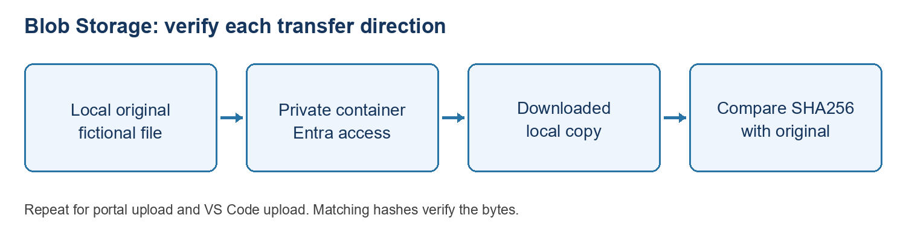

CORE ATTENDEE EDITION: Start with 00_START_HERE.md at the pack root. Only the core two-day route is supplied. Optional publishing, dummy website, resource creation, identity/networking and advanced Azure tracker extensions mentioned below are not assigned or included. Use your own extracted path where a command shows C:\YOUR-ATTENDEE-PACK. Do not copy instructor settings.

# Lab 3 - Azure Blob Storage: Portal + VS Code

**Level:** beginner \| **Time:** 40-50 minutes \| **Data:** tiny fictional text files\
**Goal:** upload in the portal, download from VS Code’s terminal, upload from your computer, and verify it in the portal. No public container, account keys, SAS, static website or application integration required.

**Course position:** Phase A, exercise 3, after the SQL exercise in the teaching order. It does not use the SQL table or require a running Function/website. Follow names -\> network preparation (1A) -\> identity preparation (1B) -\> portal upload -\> VS Code download/upload -\> portal verification -\> cleanup. After the checkpoint, continue to exercise 4, the standalone HTTP Function. Do not connect blob events or application processing yet.

## 1. Names, permissions and network

| **Item** | **Name / example** |
|----|----|
| Assigned account | Instructor-provided, e.g. YOUR-ASSIGNED-STORAGE-ACCOUNT |
| New account ONLY if approved | stlbsab011028; globally unique, 3-24 lowercase letters/numbers |
| Your private container | lab-ab01; replace ab01 with your assigned lowercase ID |
| File uploaded in portal | portal-note.txt |
| File uploaded from VS Code | vscode-note.txt |
| Local working folder | C: |

Record your actual account, subscription and container. Never use Function deployment/host containers such as azure-webjobs-\* or app-package-\* for practice. An account used by Functions is not an empty scratch account.

Instructor provides management **Reader** for portal/resource discovery and **Storage Blob Data Contributor** on your container for upload/download. To create a new container you need suitable scope on the account; if your role is container-scoped, the instructor precreates it. Do not ask for Owner or account keys as a workaround. Blob Data Reader alone cannot upload.

Network restrictions apply to portal, extension and terminal data access. A role does not bypass a private endpoint/firewall. Use the approved network.

## 1A. First-time storage access - IP rules and private containers are different

Allow 15-25 extra minutes if access has not been prepared. Read this BEFORE uploading. The instructor/administrator makes network and role changes; attendees do not change shared account settings without explicit approval.

| **Setting** | **Meaning** | **Required action** |
|----|----|----|
| Public endpoint allowed from all networks | A network route exists; identity/data permissions are still required | Do not add an IP rule unnecessarily or change a shared account |
| Public endpoint restricted to selected networks | Only approved networks/IPs can reach blob data | Instructor adds your actual public outbound IPv4 if approved |
| Public network access Disabled | Public IP rules do not enable access | Use the approved private endpoint/VPN/DNS route |
| Container Private | Anonymous callers cannot read blobs | Keep Private; use Entra authentication |

**Private container is NOT the same as private endpoint.** You can use Entra authentication to a private container over an approved public endpoint. Never enable anonymous access, use an account key or generate a SAS as a firewall/permission workaround.

### A. Inspect the network without changing it

1.  Sign in at <https://portal.azure.com>. Confirm the directory/subscription.
2.  Search Storage accounts, select YOUR-ASSIGNED-STORAGE-ACCOUNT (or your assigned account), and check the resource group/name before continuing.
3.  In the account menu, open **Security + networking \> Networking**.
4.  Record **Public network access** and whether access is from **all networks** or **selected networks**. Labels may differ between portal versions. Newer layouts show **Manage** beside public access and **View** under **Resource settings: Virtual networks, IP addresses, and exceptions**. Older layouts show the firewall fields directly.
5.  If all networks are already allowed, no IP allow-list entry is needed for this exercise. Continue to section 1B for identity permissions. Check the current account configuration; do not assume another person's example establishes access for your laptop.
6.  If Disabled, stop and use the approved private-network path. An IP rule will not override this setting. Do not turn public access on yourself.
7.  If selected networks are in use, follow B with instructor approval.

### B. Add your IP on an already-restricted account - authorised operator only

1.  Stay on the approved Wi-Fi/VPN. Record the existing setting/rules first.
2.  Open **Networking \> Resource settings: Virtual networks, IP addresses, and exceptions \> View** if shown; locate the firewall/IP address section.
3.  If **Add your client IP address** is available, check the displayed public IPv4 and select it. Otherwise get the public outbound IPv4 from the instructor/IT and enter it in the **IPv4 address or CIDR** field.
4.  Use only your real approved public IPv4, for example a value in the format `203.0.113.25` (example only; do not copy this documentation address). Do not use `192.168.x.x`, `10.x.x.x`, localhost or the storage server’s IP.
5.  For a single client, enter a single address. Do not enter a whole corporate range, `0.0.0.0/0`, or new exceptions/trusted-services settings as a shortcut.
6.  Select **Save**, wait for the success notification, then reopen the page and verify the exact IP entry is present and other settings are unchanged.
7.  Refresh the container, switch to **Microsoft Entra user account**, and try listing/downloading the assigned test blob. If it fails, stop and inspect the error; a visible account Overview is not a successful data test.
8.  If browser and CLI use different VPN/proxy routes, their public outbound IPs can differ. Have IT confirm the exact approved source IP for each; do not broaden rules to make the error disappear.

**Important:** IP rules restrict traffic only when the default network action is Deny / access is limited to selected networks. Adding an IP while all networks are allowed does NOT restrict the account. Changing an all-networks account to selected networks can break Functions or other clients using it. That is a separate owner-approved change requiring a dependency review and all required network paths to be prepared; it is NOT an attendee step here.

### C. Changed IP and safe rule removal

- A new Wi-Fi/hotspot/VPN route can change your public IP; ask the instructor to approve the replacement. Do not turn off mandatory security software.
- At the end, with owner approval, return to the same IP rules list, delete ONLY the temporary IP entry assigned to your lab, select **Save**, then confirm removal. Do not remove a shared classroom IP while others use it.
- Never restore access by selecting all networks without owner approval.

## 1B. Grant blob data permission - first-time instructor walkthrough

These are Azure roles, NOT IP firewall rules. A network allow-list entry alone cannot authorise an upload. Management Contributor/Owner alone does not grant Entra blob data access. The operator assigning roles needs `Microsoft.Authorization/roleAssignments/write` at the intended scope (for example an authorised Role Based Access Control Administrator). If **Add role assignment** is disabled, stop and ask that administrator.

1.  Instructor precreates the attendee’s private container, e.g. **lab-ab01**, using section 2. A container-scoped attendee is not expected to create containers or browse other attendees’ data.
2.  Open that exact container in the portal. In its menu choose **Access control (IAM)**. Check that the scope/resource shown is **lab-ab01**, not the entire subscription or storage account.
3.  Choose **Add \> Add role assignment**.
4.  In Role, search for and select **Storage Blob Data Contributor**. Do not select plain Contributor, Storage Account Contributor, or Owner. Choose **Next**.
5.  In Members, choose **User, group, or service principal**, then **+ Select members**. Search the attendee’s approved account or training group, verify the identity, choose **Select**, then **Next** if shown.
6.  On **Review + assign**, verify the role, attendee/group and container scope. Select **Review + assign** again if the portal uses a two-step confirmation.
7.  Open **Role assignments** at that container and verify the assignment. If it already exists at an approved scope, do not add a duplicate.
8.  For portal resource discovery, return to the storage ACCOUNT’s **Access control (IAM)**. Check the attendee has **Reader** or another approved inherited management-read role. If missing, an authorised operator repeats Add role assignment for **Reader**, scoped to that account. Do not assign broad subscription permissions for this exercise.
9.  Allow time for role propagation; Azure Storage role changes can take up to **30 minutes**. Refresh/reconnect with the intended account before retesting. Do not keep adding broader roles while waiting.
10. In the container blob view, verify the label is **Authentication method: Microsoft Entra user account**. If it says Access key, select **Switch to Microsoft Entra user account**. Do not copy keys or add listKeys rights.
11. In VS Code, sign Azure CLI in separately as described in section 5. Run the lab’s `az storage blob list ... --auth-mode login` command. Success proves this identity can list blobs on that network; an upload later proves its write permission.
12. If access fails, check BOTH network and role scope. A 403 can have several causes; record the exact error code, intended account/container and time for the instructor. Never share keys, tokens or passwords.

**Checkpoint:** instructor has confirmed the exact identity, account-read permission, container data permission and approved network path. Attendees continue with section 2. Any missing gate is Blocked, not a passed lab.

## 2. Find the account and private container in the portal

1.  Sign in to <https://portal.azure.com>; confirm directory/subscription.
2.  Search **Storage accounts**, select the assigned account.
3.  Record Overview name, region, replication and group without changing them.
4.  Go to **Data storage \> Containers**.
5.  If your container is precreated, select it. Otherwise, only with approval: choose **+ Container**, enter `lab-ab01` using YOUR ID, set anonymous access to **Private (no anonymous access)**, then Create.
6.  If already present unexpectedly, ask whose container it is; do not reuse or delete someone else’s files. Record your final assigned container name.
7.  In the portal blob view choose **Microsoft Entra user account** as the authentication method / Switch to Microsoft Entra user account if shown. Some roles cause the portal to default to account keys; do not use that shortcut for this exercise.

**Checkpoint:** your own private container opens under the correct account. No new storage account is required for the main path.

## 3. Prepare the local file and upload in the portal

1.  In VS Code use File \> Open Folder \> PortalAndVsCodeBasics.
2.  In Explorer open **Samples \> Storage \> portal-note.txt**.
3.  Read the file; it states that it contains fictional training data.
4.  Return to the portal and open your container \> **Upload**.
5.  Browse to that exact local file, choose the standard block blob/default upload, and keep the approved Hot tier for this tiny short-lived exercise.
6.  Leave overwrite OFF. If a blob already has that name, check ownership and choose a fresh instructor-approved name instead of replacing it.
7.  Select Upload, wait for success, then Refresh the container.
8.  Confirm portal-note.txt and a nonzero content length. Open its details.
9.  Use the authenticated **Download** action; open the downloaded text locally. A plain blob URL in a new browser tab may return access denied: private is intentional. Do not enable public access or generate a SAS just to browse it.

**Checkpoint:** your uploaded file can be downloaded after authenticated access. Seeing an account in Overview does not prove blob data permissions.

## 4. Inspect the account in VS Code

1.  Confirm Azure Resources extension (`ms-azuretools.vscode-azureresourcegroups`) is installed. Sign in and select the approved subscription.
2.  Optional approved extension: **Azure Storage** by Microsoft (`ms-azuretools.vscode-azurestorage`, currently preview).
3.  In Azure Resources expand Storage accounts and your assigned account. If available expand Blob Containers and your container, then Refresh.
4.  Right-click \> Open in Portal to compare the exact resource.
5.  The Storage extension offers upload/download in supported configurations, but some versions/paths require account-key permissions. If it asks for account keys, connection strings or listKeys privileges, STOP that route. Do not weaken policy. Use the explicit Entra terminal route below.

Azure Storage Explorer is a separate optional desktop application, not the VS Code extension. It can use Entra sign-in; the instructor may offer it as an alternative, not a mandatory extra tool.

## 5. Sign in to Azure CLI INSIDE the VS Code terminal

1.  Open Terminal \> New Terminal and choose PowerShell.

2.  Run:

- Get-Location
      Test-Path .\Samples\Storage\portal-note.txt
      az version

3.  Test-Path must be True. If az is missing, use the approved Azure CLI installation, reopen the terminal and retry. Do not paste commands into the VS Code search box.

4.  Sign in and confirm your context:

- az login
      az account show --query "{name:name,id:id,tenant:tenantId}" -o table

5.  If needed, use `az account set --subscription "YOUR-SUBSCRIPTION-ID"`, replacing the placeholder, then rerun account show.

6.  VS Code Azure sign-in does not automatically sign Azure CLI in.

7.  Set these values to YOUR actual resource names. Example below uses the instructor account and attendee ab01; replace both as necessary:

- $account = "YOUR-ASSIGNED-STORAGE-ACCOUNT"$container = "lab-ab01"

8.  In every data command keep **–auth-mode login**. It uses your Entra identity; do not remove it and allow an account-key fallback.

9.  After EACH `az` command, run `$LASTEXITCODE` before the next command. Expected: **0**. Any other value means stop, read the error and fix the failed step before proceeding. Native CLI failures do not necessarily stop a Windows PowerShell session, even with `$ErrorActionPreference = 'Stop'`. Do not paste the whole lab as one uninterrupted script.

## 6. List and download the PORTAL upload from VS Code

Run one command at a time; stop if any returns an error:

    az storage blob list --account-name $account --container-name $container --auth-mode login --query "[].{Name:name,Bytes:properties.contentLength}" -o table

Expected: portal-note.txt appears.

Use a new local download name and do not overwrite existing work:

    az storage blob download --account-name $account --container-name $container --name "portal-note.txt" --file ".\Samples\Storage\downloaded-portal-note.txt" --auth-mode login --overwrite false -o none

Expected: command succeeds; then run:

    Get-Content .\Samples\Storage\downloaded-portal-note.txt
    Get-FileHash .\Samples\Storage\portal-note.txt -Algorithm SHA256
    Get-FileHash .\Samples\Storage\downloaded-portal-note.txt -Algorithm SHA256

The two hashes must match. Matching proves a byte-for-byte round trip. If the download file exists, compare/keep it or choose a fresh name; do not turn overwrite on blindly.

## 7. Upload FROM VS Code and inspect in the portal

1.  Open Samples-note.txt. It has a different fictional message.

2.  Save with Ctrl+S. Confirm you have not added real information.

3.  From the same terminal run:

- az storage blob upload --account-name $account --container-name $container --name "vscode-note.txt" --file ".\Samples\Storage\vscode-note.txt" --auth-mode login --overwrite false -o none

4.  Stop on any error; silence with `-o none` is not proof by itself. Verify:

- az storage blob list --account-name $account --container-name $container --auth-mode login --query "[].name" -o table

5.  Expect portal-note.txt AND vscode-note.txt.

6.  Return to the portal, confirm the SAME account/container, and Refresh.

7.  Download vscode-note.txt using the authenticated portal action; open it and compare its content with the file you saved in VS Code.

**What “publish” means here:** an upload writes a blob immediately to Azure. There is no dotnet build/run or Deploy to Function App step. The private blob is not a public website and is not connected to the document tracker.

## 8. Tips, troubleshooting and cleanup

| **Symptom** | **Action** |
|----|----|
| Container/account name rejected | Account: lowercase letters/numbers; container: lowercase letters/numbers/hyphens, 3-63 chars, no consecutive hyphens |
| 403 AuthorizationPermissionMismatch | Correct Entra account and scoped Blob Data Contributor; role assignment propagation can take time |
| Account visible, files inaccessible | Management access and data access differ; also check network |
| Firewall / private endpoint failure | Approved VPN/private DNS and network; do not open all networks |
| Extension asks for key/listKeys | Use –auth-mode login terminal path; no privilege escalation |
| Local file not found | Get-Location and Test-Path; open parent folder, quote spaced paths |
| Blob already exists | Wrong/shared container or repeat run; inspect ownership, choose a fresh name; no blind overwrite |
| Plain blob URL fails | Expected for private data; use authenticated portal/CLI download |

Tips: keep your attendee ID in the container; Refresh after writes; compare hashes not just filenames; a successful login is not permission to upload. Record both directions in your results: Portal -\> VS Code download and VS Code -\> Portal download. No account keys/SAS in screenshots.

Cleanup ONLY with owner approval: select/delete your two lab blobs in your own container. Delete an empty attendee container only if authorised and not reused. Do not delete the storage account, host containers, shared data or Training. Keep small short-lived test blobs Hot; Cool/Cold/Archive can have minimum retention/early deletion charges depending on account type/tier.

## Instructor-only new account preparation (optional)

1.  Portal \> Storage accounts \> Create; choose approved subscription/group.
2.  Enter approved globally unique 3-24 character lowercase alphanumeric name, e.g. stlbsab011028. Select approved region.
3.  Use approved standard general-purpose account settings and redundancy; LRS may suit disposable training only after owner review.
4.  Review network policy, secure transfer, minimum TLS and disabled anonymous blob access. Do not enable static website, hierarchical namespace or paid extras just for this lab. Do not enable Shared Key to fix an extension.
5.  Review + create: check generated resources/price, approve, create and wait.
6.  Instructor precreates attendee containers and grants scoped data roles plus resource visibility. Rehearse from the attendee network before class.

## References and validation limits

- <https://github.com/microsoft/vscode-azurestorage>
- <https://learn.microsoft.com/azure/storage/blobs/authorize-data-operations-portal>
- <https://learn.microsoft.com/azure/storage/blobs/quickstart-storage-explorer>
- <https://learn.microsoft.com/azure/storage/common/storage-network-security-ip-address-range>
- <https://learn.microsoft.com/azure/storage/blobs/assign-azure-role-data-access>

# Day 1 tested walkthrough - attendee support

Updated 28 October 2026. Use this illustrated support section alongside the numbered lab; do not skip approval gates.

## 3. Blob Storage: transfer and verify actual bytes

Diagram: blob roundtrip

Open your assigned storage account \> Data storage \> Containers \> your private lab container. Select Microsoft Entra user account authentication, not Access key. Network access and Blob data permission are separate gates: a private container is not the same as a private endpoint.

The authorised instructor provides management Reader for discovery and Storage Blob Data Contributor at your container scope for transfers. An account-level assignment is broader; report it for owner review rather than removing shared access yourself. Role propagation can take up to 30 minutes. Do not keep adding roles, request Owner, copy account keys or use SAS to work around an error.

Standard route: portal-upload Samples\Storage\portal-note.txt, then download that blob from the VS Code terminal with --auth-mode login. Upload Samples\Storage\vscode-note.txt from the terminal, then Refresh the same container in the portal and Download it. Keep overwrite off. If a name already exists, confirm ownership and use an approved fresh name.

Today's rehearsal used different approved blob names: portal-check.txt for a separately prepared fictional portal file, and vscode-upload-check.txt for the supplied vscode-note.txt. Names may differ but the downloaded bytes must match the corresponding original. Do not compare portal-check.txt against portal-note.txt unless it really was uploaded from that file.

## Safe terminal download with an explicit failure check

\$account = "YOUR-APPROVED-ACCOUNT"\
\$container = "YOUR-ASSIGNED-CONTAINER"\
\$blob = "portal-note.txt"\
\$download = Join-Path \$env:TEMP ("lbs-download-" + \[guid\]::NewGuid() + ".txt")\
az storage blob download --account-name \$account --container-name \$container --name \$blob --file "\$download" --auth-mode login --overwrite false -o none\
if (\$LASTEXITCODE -ne 0) { throw "Download failed; inspect the Azure CLI error above." }\
Get-Content -LiteralPath \$download\
Get-FileHash -LiteralPath \$download -Algorithm SHA256

Replace all resource placeholders and use the actual approved blob name. A unique temporary file avoids overwriting existing work. Do not continue to read/hash a stale file after a failed transfer. Compare this download hash with the exact original file's Get-FileHash result.

## Portal download: find its real local path

In the browser's Downloads list, use Show in folder and copy the downloaded file's path. The browser may add (1) on repeated downloads. A quoted path pasted by itself does not calculate a hash. Pass it to Get-FileHash as shown below, replacing the example path.

Get-FileHash '.\Samples\Storage\vscode-note.txt' -Algorithm SHA256\
Get-FileHash 'C:\YOUR-DOWNLOAD-FOLDER\vscode-upload-check.txt' -Algorithm SHA256

Compare all characters of the Hash values, not the file names or paths. Matching SHA256 values confirm a byte-for-byte match. Today's reverse transfer matched; that hash is not an expected constant for attendees who edit their fictional source. Check both directions separately. A downloaded file opening successfully or having the right size is weaker evidence than matching hashes.

## Blob troubleshooting and cleanup

403: capture the non-secret error code and check the intended identity, container scope, role propagation and approved network. An extension asking for listKeys or a connection string is not a reason to grant more privilege; use the explicit Entra CLI route. A private blob URL refusing anonymous browser access is expected. Delete only your assigned test blobs/container with owner approval; never delete Function host containers or the shared storage account.
