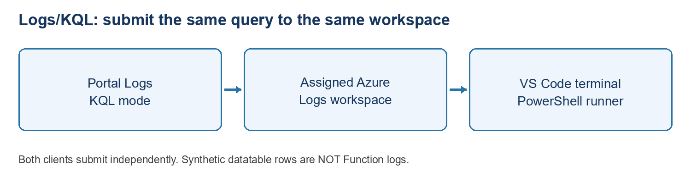

CORE ATTENDEE EDITION: Start with 00_START_HERE.md at the pack root. Only the core two-day route is supplied. Optional publishing, dummy website, resource creation, identity/networking and advanced Azure tracker extensions mentioned below are not assigned or included. Use your own extracted path where a command shows C:\YOUR-ATTENDEE-PACK. Do not copy instructor settings.

# Lab 5 - Log Analytics: Portal + VS Code

**Level:** beginner \| **Time:** 35-45 minutes\
**Goal:** run the same KQL query in the portal and from VS Code’s terminal. No application deployment, agent installation, database or ADX cluster required.

**Course position:** Phase A, exercise 5, after the standalone HTTP Function. This is an independent query exercise: its synthetic rows do not come from the Function, SQL or Blob Storage. Follow the main portal/terminal query path and record the matching result. Real telemetry exploration is optional. Complete component training before attempting a separate integration lab.

## 1. Names and prerequisites

| **Item** | **What to use** |
|----|----|
| Workspace | Instructor-assigned existing Log Analytics workspace |
| New workspace only if approved | log-lbs-ab01 (your attendee ID) |
| VS Code folder | Your extracted pack's Labs\PortalAndVsCodeBasics folder |
| Local query file | Samples\Logs\01-fictional-status.kql |
| Terminal script | Samples\Logs\Invoke-LabQuery.ps1 |
| Access | Workspace query permission, for example Log Analytics Reader |

The workspace **name**, **Workspace ID** (a GUID) and **Azure resource ID** (a /subscriptions/… path) are different. The script needs the Workspace ID. No workspace shared key, client secret or connection string is required.

Instructor example: Application Insights YOUR-ASSIGNED-FUNCTION links to YOUR-ASSIGNED-WORKSPACE in DefaultResourceGroup-SUK, not Training. Record the assigned workspace rather than assuming all course resources are in one group.

### 1A. Instructor prepares workspace query access

1.  An authorised administrator opens the assigned **Log Analytics workspace** in the portal and selects **Access control (IAM)**.
2.  Check existing assignments first. If workspace query access is missing, choose **Add \> Add role assignment** and search **Log Analytics Reader**.
3.  Select that role, choose **Next**, then **User, group, or service principal** and **Select members**. Select the approved attendee/training group.
4.  On **Review + assign**, confirm the exact workspace scope and identity; assign only after approval. Do not grant subscription Owner for this lab.
5.  If Add role assignment is unavailable, ask the authorised role administrator; an attendee cannot grant themselves access. Existing organisational table-level restrictions or private-network policies must also be honoured.
6.  Allow role propagation, refresh/reconnect, then run the small query below. Do not keep adding broader roles to bypass an error. Query access does not authorise changing ingestion, retention or workspace networking.

## 2. Find the workspace in the portal

1.  Sign in at <https://portal.azure.com> with the approved account.
2.  Verify directory/subscription. Search **Log Analytics workspaces**.
3.  Open the assigned workspace. Record its name, resource group and region.
4.  Select Overview in the workspace's left menu. In Essentials, locate Workspace ID and click its copy icon. Use this GUID for the script's -WorkspaceId argument, not Workspace Name, Subscription ID or the Azure resource ID. If this layout does not show it, check Properties. No workspace shared key is needed; use your assigned workspace's value.
5.  Select Logs and close the welcome/tutorial panel. Queries hub is a catalogue of ready-made queries grouped by category, not this lab's editor. Close it using the X at its top-right. Optionally turn off Always show Queries hub first to stop it opening automatically. Use the supplied fictional query, not the Run buttons on the hub's example cards.
6.  If the Agent toggle at the top-right is on, turn it off to leave Observability Agent chat. Use the mode dropdown above the editor on the right and select KQL mode. KQL means Kusto Query Language; this mode lets you write and run query text directly. Paste into the editor, not Agent chat, then select Run on the editor toolbar.
7.  Check the query scope at the top points to the assigned workspace.
8.  Select a short time range such as Last 24 hours for real telemetry queries.

Access to resource Overview does not necessarily mean permission to query logs. If denied, stop and request the instructor’s scoped query access.

## 3. Run a query that works even without ingested logs

1.  In VS Code open the supplied Samples\Logs\01-fictional-status.kql.

2.  Copy the complete query into a new portal Logs query tab:

```kusto
datatable(Reference:string, Status:string)
[
    "LBS-DEMO-1001", "Completed",
    "LBS-DEMO-1002", "Needs review",
    "LBS-DEMO-1003", "Received"
]
| order by Reference asc
```

3.  Select **Run**.

4.  Expected: exactly three rows in Reference order with the displayed statuses.

5.  The query creates an in-memory result only. It does NOT ingest records, create a workspace table, run document processing or read live application logs.

6.  Explain the pipe `|`: the next operator receives the previous result.

7.  Optional: before the order-by line add `| where Status == "Completed"`. Run again; expect one row. Remove this filter before the cross-tool comparison.

8.  KQL is case-sensitive for identifiers. It is not SQL: use `| where`, not SELECT FROM. Do not copy SQL statements into Logs.

**Checkpoint:** three predictable fictional rows, even in an empty workspace. This tests query execution/access, not telemetry ingestion.

## 4. Prepare VS Code and CLI

1.  Open File \> Open Folder \> your PortalAndVsCodeBasics folder.

2.  Open Terminal \> New Terminal, using PowerShell.

3.  Run:

```powershell
Get-Location
Test-Path .\Samples\Logs\01-fictional-status.kql
az version
```

4.  Expect True and Azure CLI version output. If CLI is missing, install through the approved IT process and reopen the terminal.

5.  Sign in:

```powershell
az login
az account show --query "{name:name,id:id,tenant:tenantId}" -o table
```

6.  If needed, use `az account set --subscription "YOUR-SUBSCRIPTION-ID"` with the actual assigned ID, then verify again.

7.  Browser sign-in, Azure Resources sign-in and CLI sign-in are separate.

8.  A .kql file is just saved text. No VS Code extension is needed to submit it using the supplied PowerShell/CLI route. Syntax-colouring extensions are optional and must be approved; do not assume an ADX extension targets Logs.

## 5. Run the SAME query from your computer against Azure

1.  Confirm your terminal is in PortalAndVsCodeBasics.

2.  Replace YOUR-WORKSPACE-ID with the GUID from Part 2:

```powershell
.\Samples\Logs\Invoke-LabQuery.ps1 -WorkspaceId "YOUR-WORKSPACE-ID"
```

3.  Expected: the same three Reference/Status rows and a PASS message.

4.  The script checks the supplied .kql file against the companion 01-fictional-status.request.json, submits that JSON to the Azure Monitor Logs query endpoint with CLI sign-in, and validates all three expected rows. The JSON file avoids Windows command-line quoting issues; keep both query copies unchanged for this first test. The token is managed by CLI; it is not printed or saved by the script.

5.  This is a remote query launched from VS Code, not an offline KQL engine. The portal and terminal submit to the same workspace.

6.  If your organisation blocks scripts or CLI consent, use the approved portal route and record the terminal step Blocked; do not bypass policy.

**What “publish” means:** submitting a query executes it remotely. Saving the .kql file locally does not deploy anything. This beginner lab creates no ingestion rule, alert, dashboard, agent, table or paid resource.

## 6. Optional: inspect REAL Function telemetry

Only if the instructor confirms telemetry is connected and grants access:

1.  Use the approved Function URL with a function-level key to make a few GET calls as in the earlier Function lab. Keep keys out of files/screenshots.

2.  In the linked workspace Logs, inspect **Tables** first.

3.  If **AppRequests** exists, run:

```kusto
AppRequests
| where TimeGenerated > ago(1h)
| where AppRoleName =~ "YOUR-ASSIGNED-FUNCTION"
| project TimeGenerated, Name, ResultCode, Success, DurationMs
| order by TimeGenerated desc
| take 20
```


4.  Replace YOUR-ASSIGNED-FUNCTION if your assigned app has another role name. Confirm the actual AppRoleName with the instructor rather than guessing.

5.  Expect recent requests if collection is configured and data has arrived; exact counts vary. Allow ingestion delay and rerun before widening to 24h.

6.  A missing table is different from zero matching rows. Missing AppRequests means this workspace may not collect that table; do not create one to fix it.

7.  If querying **Application Insights \> Logs** instead, the resource-scoped schema may expose `requests` with `timestamp`, `name`, `resultCode`, `success`, `duration` and `cloud_RoleName`. Do not mix these with workspace AppRequests column names. Confirm scope/schema before adapting the query.

8.  No data? Record that truthfully. The fictional query passing does not prove telemetry ingestion works. Changing instrumentation is a separate approved lab.

## 7. Troubleshooting and tips

| **Symptom** | **Action** |
|----|----|
| 403 / access denied | Correct account, tenant and workspace query role; allow role propagation |
| Workspace not found | Use Workspace ID GUID, not its name, tenant ID, subscription ID or resource ID |
| CLI sign-in/consent error | Approved tenant/login and IT consent; do not create app registrations or secrets |
| File not found | Correct parent folder; Test-Path before running script |
| Query syntax error | Complete KQL, correct case and straight quotes; no SQL SELECT syntax |
| Real table missing | Verify scope/Tables; use fictional query for basics; do not assume ingestion |
| Zero real rows | AppRoleName, time range, collection configuration and ingestion delay |
| Tables have requests instead of AppRequests | Application Insights resource scope uses different schema |
| Logs blade is blank / keeps loading | Refresh once; confirm sign-in/directory and use the supported regular browser. If it persists, record Blocked and ask instructor/IT to check portal loading errors; do not change workspace/network settings as a workaround |
| Wrong workspace/folder in VS Code | Use File \> Open Folder for PortalAndVsCodeBasics; open a new PowerShell terminal and rerun Get-Location/Test-Path |

Tips: select only the intended complete query before Run; use early time filters and take 20 for real data; save local queries with descriptive names; do not export real logs containing personal information as course evidence.

## 8. Results and cleanup

Record workspace name/group, query time, portal row count and terminal result. Expected: fictional query returns 3 rows in BOTH tools. Real telemetry is a separate optional result; mark it Not run/No data rather than Passed.

No Azure cleanup is needed: the read-only lab creates no resource or data. Close query tabs and sign out of shared machines. Do not delete the workspace, change retention/daily cap or purge logs.

## Instructor-only new workspace preparation (optional)

1.  Only with budget/region approval: portal \> Log Analytics workspaces \> Create.
2.  Choose approved subscription, resource group, region and unique-in-group name such as log-lbs-ab01.
3.  Review pricing/retention and policy; do not assume ingestion is free.
4.  Review + create, approve, create and wait. Grant appropriate query access.
5.  A new workspace starts without application logs. The datatable query still works; real collection requires a separate configured source.

## References and limits

- <https://learn.microsoft.com/azure/azure-monitor/logs/get-started-queries>
- <https://learn.microsoft.com/azure/azure-monitor/logs/api/request-format>
- <https://learn.microsoft.com/azure/azure-monitor/logs/api/access-api>

# Day 1 tested walkthrough - attendee support

Updated 28 October 2026. Use this illustrated support section alongside the numbered lab; do not skip approval gates.

## 5. Logs/KQL: same synthetic query in two clients



Diagram: logs query

In Azure portal open the assigned Log Analytics workspace, not just the Function App. It can be in a different resource group. Overview \> Essentials \> Workspace ID \> copy icon gives the GUID needed by the runner. If it is not shown in that layout, check Properties. Do not copy Workspace Name, Subscription ID or the Azure resource ID. No shared key is needed.

Open Logs. Close Welcome to Log Analytics with its top-right X. Queries hub is a catalogue of ready-made examples, not this lab's editor. Optionally turn off Always show Queries hub, then close the hub with X. Do not use the Run buttons on its example cards for this checkpoint.

If the top-right Agent toggle is on, turn it off to leave Observability Agent chat. Select KQL mode from the dropdown above the editor on the right. KQL means Kusto Query Language. Paste into the query editor, not Agent chat, then click Run on the editor toolbar.

```kusto
datatable(Reference:string, Status:string)
[
    "LBS-DEMO-1001", "Completed",
    "LBS-DEMO-1002", "Needs review",
    "LBS-DEMO-1003", "Received"
]
| order by Reference asc
```

Expect exactly three rows in Reference order: Completed, Needs review, Received. datatable makes an in-memory fictional result; it does not create/ingest a table or read Function logs. The pipe sends the result to the next operator. KQL identifiers are case-sensitive; do not paste SQL SELECT syntax here.

In the existing VS Code terminal change to Labs\PortalAndVsCodeBasics. No new window is required. Confirm CLI sign-in, then run the supplied script with the same workspace's GUID.

```powershell
.\Samples\Logs\Invoke-LabQuery.ps1 -WorkspaceId "YOUR-WORKSPACE-ID"
```

Replace the placeholder. Expect the same three Reference/Status rows and PASS Azure Monitor query: exactly three expected fictional rows. The script checks the KQL and companion request JSON agree, submits a remote Azure Monitor query and validates exact values. Keep both query copies unchanged for the first comparison. A local .kql file is just saved text until submitted. If query access is denied, ask for scoped workspace access; do not grant yourself broader roles.

Optional real telemetry is a separate exercise requiring configured collection, approved access and ingestion time. A successful synthetic query does not prove Function telemetry exists. Inspect actual table names/schema before using AppRequests or resource-scoped requests.
