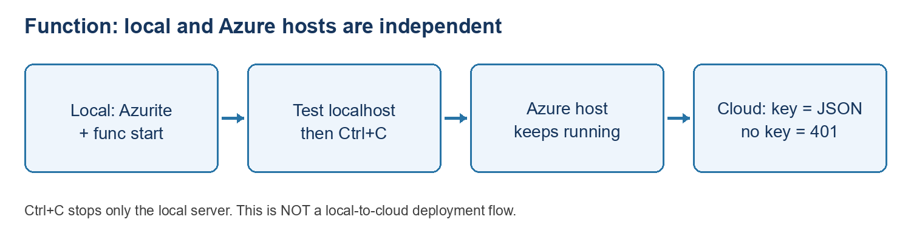

CORE ATTENDEE EDITION: Start with 00_START_HERE.md at the pack root. Only the core two-day route is supplied. Optional publishing, dummy website, resource creation, identity/networking and advanced Azure tracker extensions mentioned below are not assigned or included. Use your own extracted path where a command shows C:\YOUR-ATTENDEE-PACK. Do not copy instructor settings.

# Core lab: VS Code and a standalone HTTP Azure Function

**Audience:** attendees new to Azure\
**Platform:** Windows, PowerShell and VS Code\
**Estimated time:** 90-120 minutes after prerequisites are installed\
**Updated:** 28 October 2026

## What you will do, in order

### Course route - components first, integration later

**Orientation-only prerequisites:** VS Code, Azure Resources extension and your approved Azure sign-in are sufficient for course exercise 1. In Part 1, complete sections 1.1 and 1.2, confirm Azure Resources is installed using section 1.4’s extension table, then continue to Part 2. Skip the .NET, Core Tools, C# and Azurite checks until returning for the Function exercise. Do not let a missing `func` command block resource discovery.

This reference guide contains several independent exercises, NOT one integrated application. Use the [course order](Basic_Lab_00_START_HERE.md) when following the full component training:

| **Course exercise** | **Use these parts of this guide** | **Where to stop** |
|----|----|----|
| 1 - Orientation/resource access | Parts 1 and 2 | Stop before running a Function; continue with the separate SQL and Storage labs |
| 4 - Standalone HTTP Function | Recheck prerequisites, then Parts 3 and 5 and Function-related Part 8 evidence/cleanup | Skip the dummy website and its publishing appendix; continue to the Logs lab |

Core route: orientation in Parts 1-2, local Function in Part 3, cloud test-only in Part 5, and evidence/cleanup in Part 8. Original numbering is retained; publishing and dummy-website sections are intentionally omitted.

### Reference sequence within this guide

1.  Find the supplied project and check the tools.
2.  Sign in to Azure from VS Code and inspect existing resources.
3.  Open and run a simple HTTP Function locally.
4.  Test the cloud Function in the portal and browser.
5.  Stop your local applications and record your results.

**Keep it basic: this HTTP Function is independent of SQL, Blob and Service Bus. The Day 2 local document tracker is a separate project. Use fictional data only.**

### Read these instructions before copying commands

- **Bold text** usually means a button/menu or an important warning.
- A command block is typed into the VS Code PowerShell terminal. Do not type the words “powershell”, the `PS ...>` prompt or expected output.
- Replace `YOURID` with a short assigned attendee ID, for example `ab01`. Do not use your email address, customer name or confidential identifier.
- Menu labels can vary by extension/portal release. Search the Command Palette with Ctrl+Shift+P when an action is hard to find.
- **Local** means your own laptop; **Azure** means the cloud resource. A local test and a cloud test are separate checkpoints.

## What names should I give things?

Use the supplied project names unchanged so all commands in this guide match. Only cloud target names vary per attendee.

| **Item** | **Name / example to use** | **Why** |
|----|----|----|
| Local parent folder | `C:\AzureLabs\VsCodePublishBasics` (recommended) | Short path; same layout as the supplied pack |
| Function project folder | `HelloAzureFunction` | Contains HelloAzureFunction.csproj |
| Function class / function name | `ApplicationStatus` | Becomes the /api/ApplicationStatus route |
| Resource group | Instructor-assigned group, for example Training | Do not create a duplicate or use another group’s resources |
| Local Function port | 7071 | Local HTTP Function address |

**Three names that are easy to confuse:** `HelloAzureFunction` is your local project; `ApplicationStatus` is the function inside it; `func-lbs-ab01-1028` is an example cloud host that runs the deployed project. They do not have to be the same name.

| **Application** | **Runs where in this lab?** | **What it does** |
|----|----|----|
| HelloAzureFunction | Your computer, then an approved Azure Function App | GET request returns one fixed fictional JSON response |

## Before you begin: instructor preparation

The instructor must provide these details before attendees start. Do not guess targets or create resources to resolve missing access.

| **Detail** | **Value to record** |
|----|----|
| Work/training sign-in account | \_\_\_\_\_\_\_\_\_\_\_\_\_\_\_\_\_\_\_\_\_\_\_\_\_\_\_\_\_\_ |
| Directory / tenant | \_\_\_\_\_\_\_\_\_\_\_\_\_\_\_\_\_\_\_\_\_\_\_\_\_\_\_\_\_\_ |
| Subscription name and ID | \_\_\_\_\_\_\_\_\_\_\_\_\_\_\_\_\_\_\_\_\_\_\_\_\_\_\_\_\_\_ |
| Resource group | \_\_\_\_\_\_\_\_\_\_\_\_\_\_\_\_\_\_\_\_\_\_\_\_\_\_\_\_\_\_ |
| Assigned existing Function App for test-only | \_\_\_\_\_\_\_\_\_\_\_\_\_\_\_\_\_\_\_\_\_\_\_\_\_\_\_\_\_\_ |
| Function runtime | .NET 10 isolated, Functions v4 |
| Local project folder | \_\_\_\_\_\_\_\_\_\_\_\_\_\_\_\_\_\_\_\_\_\_\_\_\_\_\_\_\_\_ |

**Shared-app rule: this core route is test-only. Never publish over the assigned Function App; replacement authority is not included.**

**Complete Parts 1-3, test the assigned existing Function in Part 5, then record Function evidence/cleanup in Part 8. Obtain permission to use a function key; management Reader alone does not grant key access.**

# Part 1 - Prepare VS Code and find the correct folder

## 1.1 Open the supplied project

1.  Download/extract the instructor’s lab pack to a folder you can edit. If it is a ZIP, extract it first; do not run inside the ZIP preview. Recommended: use File Explorer to create `C:\AzureLabs`, then copy the complete supplied **VsCodePublishBasics** folder into it. If corporate policy prevents this location, use a writable location provided by IT.

2.  Open **Visual Studio Code**.

3.  Select **File \> Open Folder**.

4.  Browse to and select **VsCodePublishBasics**, then choose **Select Folder**.

5.  If VS Code asks about workspace trust, trust only the instructor-supplied files after confirming their source.

6.  Look at the Explorer on the left. Confirm these items exist:

```text
VsCodePublishBasics
  HelloAzureFunction
    HelloAzureFunction.csproj
    ApplicationStatus.cs
    Program.cs
    host.json
    local.settings.example.json
  Basic_Self_Paced_Lab.md
  README.md
```

You are not using the older SQL sample or the original processing tracker. If you see only the SQL project, open the correct folder before continuing.

## 1.2 Open PowerShell in VS Code

1.  Select **Terminal \> New Terminal**.

2.  Check the terminal profile says **PowerShell**. If not, use the terminal’s drop-down menu, choose PowerShell, and open a new terminal.

3.  Run:

```powershell
Get-Location
Get-ChildItem
Test-Path .\HelloAzureFunction\HelloAzureFunction.csproj
```

4.  The last command must return `True`. If it returns `False`, navigate to your extracted **VsCodePublishBasics** folder and run the check again.

If you used the recommended folder, run:

    Set-Location -LiteralPath "C:\AzureLabs\VsCodePublishBasics"

Instructor-machine example ONLY (not the location on every attendee laptop):

    Set-Location -LiteralPath "C:\YOUR-ATTENDEE-PACK\Labs\VsCodePublishBasics"

**How to enter commands:** copy only the command, not the `PS C:\...>` prompt or expected output. Press Enter. If you see `>>` unexpectedly, PowerShell is waiting for an unfinished quote/bracket; press Ctrl+C, then paste the complete command again. Keep quotes around paths containing spaces.

## 1.3 Check .NET

Run:

    dotnet --list-sdks

Expected: at least one line beginning with `10.0.`. This lab uses the .NET **SDK**, not just the runtime.

If `dotnet` is not recognised or SDK 10 is missing, stop and use your organisation’s approved .NET 10 SDK installation process. Close and reopen the terminal afterwards. A corporate installation may require IT assistance.

## 1.4 Check extensions and Function tools

1.  Select **Extensions** on the left, or press Ctrl+Shift+X.

2.  Search for and install/confirm the approved extensions:

| **Extension**   | **Publisher / identifier**                             |
|-----------------|--------------------------------------------------------|
| Azure Resources | Microsoft / `ms-azuretools.vscode-azureresourcegroups` |
| Azure Functions | Microsoft / `ms-azuretools.vscode-azurefunctions`      |
| C#              | Microsoft / `ms-dotnettools.csharp`                    |
| Azurite         | Microsoft / `Azurite.azurite`                          |

3.  Run this in the terminal:

```powershell
func --version
```

4.  Expected: version `4.x`. The installed release must support .NET 10. If missing, use the instructor/IT-approved Azure Functions Core Tools v4 installation instructions at <https://learn.microsoft.com/azure/azure-functions/functions-run-local>. Reopen the terminal after installation.

5.  Do not try `dotnet run` as a replacement for the Function host. This Function needs Core Tools (`func start`); the separate Day 2 tracker uses `dotnet run`.

**Checkpoint 1:** you found the project, `Test-Path` returned True, SDK 10 is available, and Function prerequisites are ready. If Core Tools is blocked, record that limitation and use the cloud test route; do not claim a local Function test passed.

For orientation only, the checkpoint is the correct folder, VS Code and Azure Resources extension; SDK/Core Tools checks are deferred, not failed.

# Part 2 - Connect VS Code to Azure and inspect resources

## 2.1 Sign in

1.  Select the **Azure** icon in the Activity Bar.
2.  Under **Resources**, select **Sign in to Azure**. If not visible, press Ctrl+Shift+P and search for the Azure sign-in command.
3.  Complete browser sign-in with the approved work/training account and MFA.
4.  Return to VS Code after sign-in completes.
5.  Use the Resources menu or **Azure: Select Subscriptions** command to select only the instructor-approved subscription.
6.  Refresh the Resources tree.
7.  Verify the directory and subscription against your preparation table. Menu wording may vary with extension version.

Signing in to a browser, the VS Code Azure extension and Azure CLI are separate sessions. This lab’s extension path does not require `az login`.

## 2.2 Inspect, without changing anything

1.  Expand **Function Apps** and locate your assigned Function App.

2.  Right-click it and select **Open in Portal**, where available.

3.  In the portal Overview, record the app name, subscription, resource group and region. Return to VS Code.

4.  Locate a storage account, SQL database/server and Service Bus namespace. If a type is not exposed by the extension, use the portal’s resource group resource list instead.

5.  Record what you can see:

| **Resource type** | **Name** | **Region** |
|----|----|----|
| Function App | \_\_\_\_\_\_\_\_\_\_\_\_\_\_\_\_\_\_ | \_\_\_\_\_\_\_\_\_\_\_\_\_\_\_\_\_\_ |
| Storage account | \_\_\_\_\_\_\_\_\_\_\_\_\_\_\_\_\_\_ | \_\_\_\_\_\_\_\_\_\_\_\_\_\_\_\_\_\_ |
| SQL database/server | \_\_\_\_\_\_\_\_\_\_\_\_\_\_\_\_\_\_ | \_\_\_\_\_\_\_\_\_\_\_\_\_\_\_\_\_\_ |
| Service Bus namespace | \_\_\_\_\_\_\_\_\_\_\_\_\_\_\_\_\_\_ | \_\_\_\_\_\_\_\_\_\_\_\_\_\_\_\_\_\_ |

Do not open storage connection strings, copy secrets, change networking or delete resources. Seeing a resource does not prove data access or deployment permission.

**Checkpoint 2:** identify the selected subscription and at least four resource types. If missing, check account/directory, subscription filters and access. Ask the instructor rather than creating duplicate resources.

# Part 3 - Run the supplied HTTP Function locally

## 3.1 Open the Function project by itself

1.  Select **File \> New Window**.

2.  In the new window select **File \> Open Folder**.

3.  Open the **HelloAzureFunction** folder inside your lab pack.

4.  Open **Terminal \> New Terminal** and run:

```powershell
Get-Location
Test-Path .\HelloAzureFunction.csproj
```

5.  Confirm `True`. You must be inside the Function subfolder for these commands.

6.  Open **ApplicationStatus.cs**. Find the HTTP trigger. It uses GET and Function-key authorisation. It returns fixed fictional values; no inputs or document upload are required.

## 3.2 Create local-only settings and build

Run this complete block once:

    if (-not (Test-Path .\local.settings.json)) {
        Copy-Item .\local.settings.example.json .\local.settings.json
    }
    dotnet build .\HelloAzureFunction.csproj

Expected: **Build succeeded**. Existing local settings are left unchanged. The sample uses `UseDevelopmentStorage=true`, which means local Azurite, not the instructor’s Azure storage account.

Never commit or publish local settings. If an existing settings file points at another developer’s services, stop and ask before using or changing it.

## 3.3 Start Azurite and the Function host

1.  Press Ctrl+Shift+P.

2.  Run **Azurite: Start**. Confirm it starts without an error notification.

3.  In the Function terminal run:

```powershell
func start --port 7071
```

4.  Wait for the host to list `ApplicationStatus` with an address resembling:

- http://localhost:7071/api/ApplicationStatus

5.  Leave this terminal running. Do not press Ctrl+C yet.

## 3.4 Test from a SECOND terminal

1.  Select **Terminal \> New Terminal** or the terminal panel’s **+** button. The first terminal must continue running the host.

2.  In the second terminal run:

```powershell
Invoke-RestMethod "http://localhost:7071/api/ApplicationStatus"
```

3.  Confirm:

- reference      LBS-DEMO-1001
      status         Received
      fictionalData  True
      message        Hello from the VS Code publishing exercise.

  PowerShell may format these values as a table instead of JSON; the values should match.

4.  You can also open the local address in a browser to see the JSON.

5.  After completing local tests, click inside the FIRST terminal running func start and press Ctrl+C. Wait for the PowerShell prompt to return. The second terminal is just a request client. Why: func start keeps a local server running; Ctrl+C stops it, releases port 7071 and local resources, and helps avoid build file locks. It does not delete code, undo the build or stop the deployed Azure Function. The localhost URL stops responding; the cloud URL is independent. Logs/KQL does not need the local server. To restart, ensure Azurite is running and run func start --port 7071 in the Function project folder.

**Checkpoint 3:** record local Function result and time. Core Tools normally does not enforce keys locally; cloud key requirements are tested separately.

If localhost times out but the host reports that it is listening, test the explicit loopback address, using the port printed by your host:

```powershell
curl.exe --noproxy "*" --fail --max-time 20 http://127.0.0.1:7071/api/ApplicationStatus
```

Replace 7071 only if you started the host on another port. This bypass is limited to the local request; do not disable corporate proxies or security controls globally.

# Part 5 - Test the Function on Azure

## 5.1 Test using the portal

1.  Open <https://portal.azure.com> and sign in with the approved account.

2.  Open **Function Apps \> your approved Function App**.

3.  Under **Functions**, select **ApplicationStatus**.

4.  Open **Code + Test**, then select **Test/Run**.

5.  The portal may show `functions.metadata` rather than editable C# source. This is normal for compiled isolated Functions. Edit C# in VS Code; do not edit generated metadata.

6.  In the Test/Run panel select **Input** and set:

| **Field**          | **Value**                                   |
|--------------------|---------------------------------------------|
| HTTP method        | GET                                         |
| Key                | Prefer default (Function key), if available |
| Query parameters   | Empty                                       |
| Headers            | Empty                                       |
| Body, if displayed | Empty                                       |

7.  The `_master` host key is more privileged than this test needs. Prefer a function-level key; if you cannot obtain one, ask the instructor.

8.  Select **Run**, then **Output**.

9.  Expect **HTTP response code: 200 OK** and:

- {
        "reference": "LBS-DEMO-1001",
        "status": "Received",
        "fictionalData": true,
        "message": "Hello from the VS Code publishing exercise."
      }

10. In the logs look for an executed `Functions.ApplicationStatus` entry with **Succeeded**. Telemetry on other pages may appear after a delay.

## 5.2 Test using the Function URL

1.  Close the Test/Run panel.
2.  Select **Get function URL** on the Function page.
3.  Choose default (Function key), if offered, not default (Host key) or \_master (Host key). Click the copy icon beside that function-key URL. Copy the full URL directly into your browser, never into chat.
4.  Paste it into your browser address bar and press Enter.
5.  Expect the same four-field JSON response.
6.  Do not send that full key-bearing URL in chat, email, screenshots or GitHub. It authorises calls. Function keys are not a user sign-in system.
7.  To test access protection, copy the endpoint into a second browser tab and remove the `?code=...` query string. With no key, expect **HTTP 401**. A browser may show an error page rather than a JSON body. The instructor’s endpoint returned 401; some access policies may reject with 403.
8.  Never disable authentication just to make the keyless request succeed. If a key or keyed URL is exposed, coordinate with the authorised owner to renew/regenerate the matching key before retesting. Use the function's Function Keys for a function-scoped key or the Function App's App keys for a host-scoped key. Existing callers using that value must be updated. Never share the replacement.

## 5.3 Record the result, not the key

Write the function name, time, HTTP status and whether all four response values matched. Take a screenshot of the Output tab only after checking no secrets or key-bearing URL are visible.

**Checkpoint 5:** keyed request returns 200 with correct JSON; request without a key is rejected. This proves an HTTP Function works. It does not prove document processing or connectivity to another Azure service.

# Part 8 - Finish safely and record your evidence

## 8.1 Complete this results sheet

| **Check** | **Expected** | **Your result / time** |
|----|----|----|
| Correct project folder | HelloAzureFunction.csproj exists | \_\_\_\_\_\_\_\_\_\_\_\_\_\_\_\_\_\_ |
| Azure account and subscription | Instructor-approved target | \_\_\_\_\_\_\_\_\_\_\_\_\_\_\_\_\_\_ |
| Resource discovery | Four resource types identified | \_\_\_\_\_\_\_\_\_\_\_\_\_\_\_\_\_\_ |
| Local Function | Fixed response from port 7071, or honestly record Not run | \_\_\_\_\_\_\_\_\_\_\_\_\_\_\_\_\_\_ |
| Cloud Function with key | HTTP 200; four exact values | \_\_\_\_\_\_\_\_\_\_\_\_\_\_\_\_\_\_ |
| Cloud Function without key | Rejected: instructor observed HTTP 401 | \_\_\_\_\_\_\_\_\_\_\_\_\_\_\_\_\_\_ |

## 8.2 Stop only your own local applications

1.  Stop any remaining local Function host with Ctrl+C in the terminal running func start; wait for the PowerShell prompt. This stops only the local server, not the Azure Function App. On the core test-only route, record publishing as Not run. After Function evidence and cleanup, continue to the Logs/KQL lab. The dummy website is not supplied.
2.  If you started Azurite for this exercise and no other work needs it, run **Azurite: Close** from the Command Palette.
3.  Browser refresh failing after shutdown is expected.
4.  Do not delete the shared **Training** resource group, Function App, plan, storage account or any other existing Azure resource.
5.  Azure cleanup or restoration of previous Function code is instructor-owned and needs separate approval. This lab creates no new resources by default.

# Troubleshooting - match your error before changing anything

| **Symptom** | **Likely cause** | **What to do** |
|----|----|----|
| Local Function URL cannot connect | Host is stopped, still starting, failed, or using another port | Follow Part 3.3; wait for the ApplicationStatus route and keep the host running |
| Browser tab exists but page will not load | A tab is not a running server | Confirm Function host output and the exact URL, then retry |
| func is not recognised | Core Tools missing or terminal PATH stale | Follow Part 1 prerequisites; reopen terminal; do not substitute dotnet run |
| dotnet is not recognised | SDK missing or PATH stale | Use approved SDK install; reopen terminal |
| NETSDK error about net10.0 | Wrong/older SDK selected | Check dotnet --list-sdks and ask instructor; do not downgrade blindly |
| Storage connection refused when starting Function | Azurite not running or port conflict | Start Azurite; inspect its output; keep emulator settings local |
| Address already in use | Another process owns the port | Do not kill unrelated processes; inspect existing app or ask instructor |
| PowerShell shows \>\> | Incomplete pasted command | Ctrl+C; paste the whole command with matching quotes |
| Script execution is disabled by policy | Corporate PowerShell policy | Ask IT/instructor for approved execution; do not bypass organisation policy |
| Cloud URL returns 401 | Missing/wrong Function key | Use Get function URL privately; do not disable authorisation |
| Portal test cannot fetch / browser network error | Browser/network/CORS/access restrictions may block portal calls | Try the approved full Function URL; give instructor the non-secret error; do not change CORS/network rules blindly |
| Function returns 404 or is not listed | Wrong target/path, deployment or indexing issue | Confirm app and /api/ApplicationStatus path; inspect deployment/host logs with instructor |

If the Function port is occupied, ask the instructor or choose an approved free loopback port and update both the host command and request URL.

# Day 1 tested walkthrough - attendee support

Updated 28 October 2026. Use this illustrated support section alongside the numbered lab; do not skip approval gates.

## 4. Function: build, local invocation and cloud invocation



Diagram: function local cloud

Open Labs\VsCodePublishBasics\HelloAzureFunction. Confirm the .csproj, ApplicationStatus.cs and host.json are present. Use the approved .NET 10 SDK, .NET-10-compatible Core Tools v4 and Azurite. If func is not found, approved tools must be installed/enabled in this terminal. The instructor's portable Enable-LocalTrainingTools.ps1 helper is not a universal attendee prerequisite; use it only if supplied and approved.

```powershell
dotnet --list-sdks
func --version
if (-not (Test-Path '.\local.settings.json')) {
    Copy-Item '.\local.settings.example.json' '.\local.settings.json'
}
dotnet build
```

Do not overwrite existing local settings. The example uses local Azurite storage, not Azure account keys. Never publish local.settings.json. A successful build proves compilation only, not a running HTTP endpoint.

Press Ctrl+Shift+P \> Azurite: Start. In terminal 1 run the host; keep it running until local tests finish. Open terminal 2 for the request.

Terminal 1:

```powershell
func start --port 7071
```

Terminal 2:

```powershell
curl.exe --noproxy "*" --fail --max-time 20 http://127.0.0.1:7071/api/ApplicationStatus
```

Wait for the host to list ApplicationStatus: \[GET\] before testing. The explicit IPv4 loopback command helped during rehearsal; its proxy bypass is limited to this local request, not corporate networking globally. If the port is occupied, do not kill someone else's process. Use an approved alternative port and update both the host and request.

{"reference":"LBS-DEMO-1001","status":"Received","fictionalData":true,"message":"Hello from the VS Code publishing exercise."}

## Why press Ctrl+C?

Click inside terminal 1 running func start and press Ctrl+C after local testing. Wait for Host shutdown completed and the PowerShell prompt. This stops only your local server, frees port 7071 and local resources, and helps avoid build file locks. It does not delete code, undo the build or stop the Azure Function App. localhost stops responding; the cloud URL remains independent. Restart with Azurite running and func start --port 7071. Logs/KQL does not require the local host.

## Shared cloud Function: test-only route

Do not redeploy the shared app to repeat this checkpoint. Publishing replaces deployed content and requires a separately approved compatible .NET 10 isolated target. Record publishing as Not run / test-only if not authorised; a build or cloud invocation does not prove VS Code publishing.

In the approved Function App select Functions \> ApplicationStatus \> Get Function URL. Choose default (Function key), not default (Host key) or \_master (Host key). Click the copy icon and paste the full URL directly into your browser address bar, never chat. Expect the same four-field JSON. The portal Code + Test \> Test/Run route can separately show 200 OK; a browser JSON body alone does not display its exact HTTP status.

In a separate browser tab remove ?code= and everything after it. Expected: HTTP 401 Unauthorized. The browser's error page is a passing negative access test, not a broken app. Local Core Tools normally does not enforce keys, so a local keyless response does not replace this cloud check.

## If a key is accidentally shared

Stop using it. Coordinate with the authorised owner to regenerate the exact exposed key: Function Keys for a function key, App keys for a host key. Update affected callers and obtain a fresh private URL. Confirm old-key invalidation through the approved private process; do not assume renewing a different key fixes it. Never paste the replacement into evidence. Function keys are shared access secrets, not individual user sign-in.
