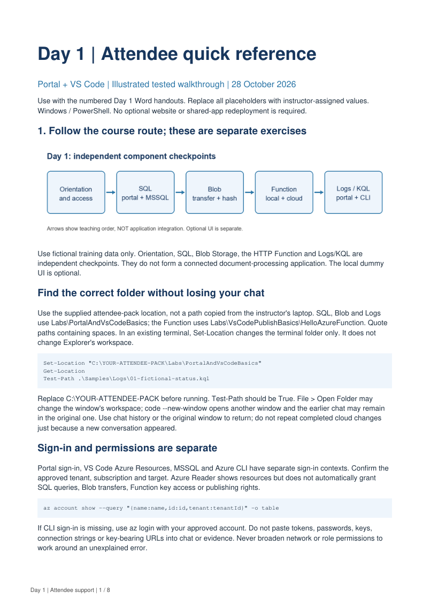
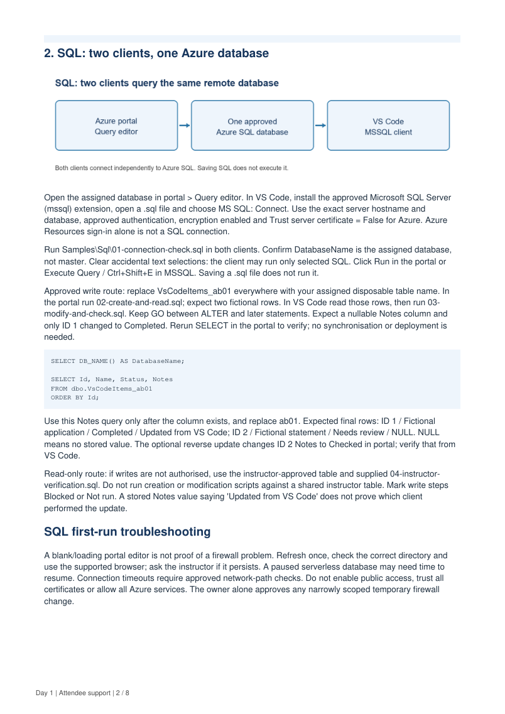
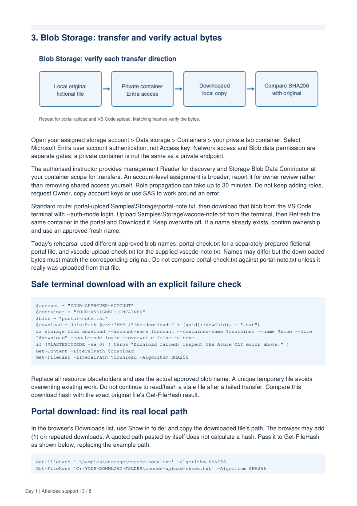
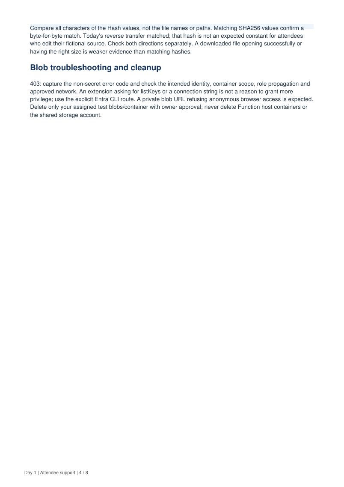
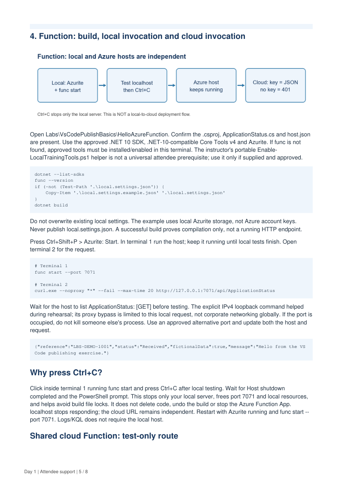
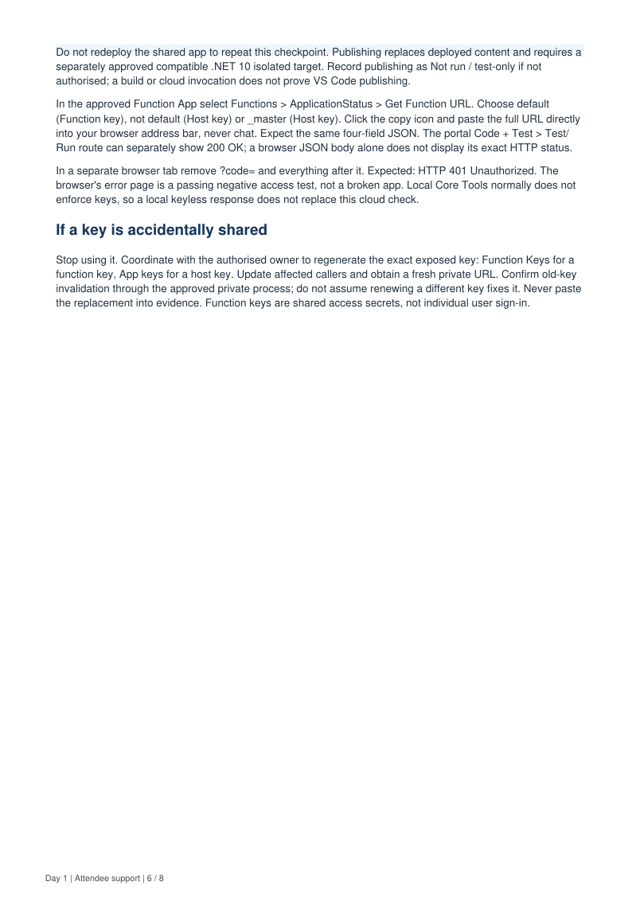
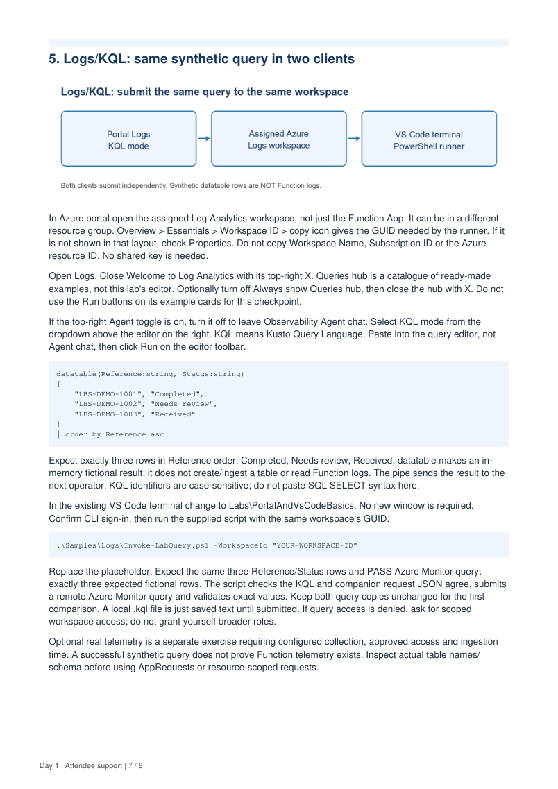
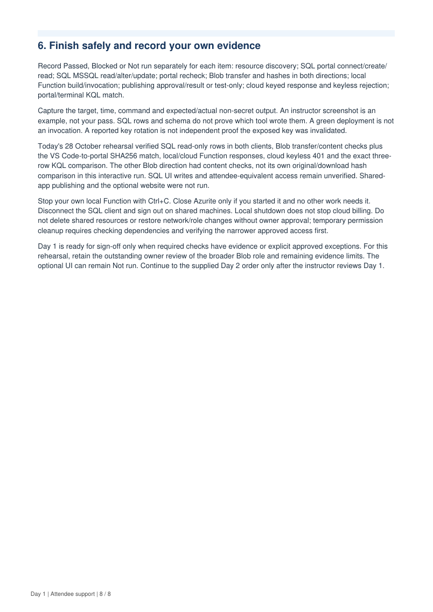

# Day 1 illustrated quick reference

Searchable page text with the original rehearsal page layout preserved below each section. Fictional training data only.

Use the current [Day 1 order](00_DAY_1_ORDER.md) and numbered handouts for
copyable commands and the assigned route. The historical page images below are
visual examples, not additional instructions or proof of your own results.
The older dummy UI is not supplied; cloud Function testing is test-only.

## Page 1

Day 1 | Attendee quick reference

  Portal + VS Code | Illustrated tested walkthrough | 28 October 2026

  Use with the numbered Day 1 Markdown handouts. Replace all placeholders with instructor-assigned values.
  Windows / PowerShell. No optional website or shared-app redeployment is required.

  1. Follow the course route; these are separate exercises

  Use fictional training data only. Orientation, SQL, Blob Storage, the HTTP Function and Logs/KQL are
  independent checkpoints. They do not form a connected document-processing application. The Day 2
  tracker is a separate local-only exercise.

 Find the correct folder without losing your chat

  Use the supplied attendee-pack location, not a path copied from the instructor's laptop. SQL, Blob and Logs
  use Labs\PortalAndVsCodeBasics; the Function uses Labs\VsCodePublishBasics\HelloAzureFunction. Quote
  paths containing spaces. In an existing terminal, Set-Location changes the terminal folder only. It does not
  change Explorer's workspace.

    Set-Location "C:\YOUR-ATTENDEE-PACK\Labs\PortalAndVsCodeBasics"
    Get-Location
    Test-Path .\Samples\Logs\01-fictional-status.kql

  Replace C:\YOUR-ATTENDEE-PACK before running. Test-Path should be True. File > Open Folder may
  change the window's workspace; code --new-window opens another window and the earlier chat may remain
   in the original one. Use chat history or the original window to return; do not repeat completed cloud changes
   just because a new conversation appeared.

 Sign-in and permissions are separate

  Portal sign-in, VS Code Azure Resources, MSSQL and Azure CLI have separate sign-in contexts. Confirm the
  approved tenant, subscription and target. Azure Reader shows resources but does not automatically grant
 SQL queries, Blob transfers, Function key access or publishing rights.

    az account show --query "{name:name,id:id,tenant:tenantId}" -o table

    If CLI sign-in is missing, use az login with your approved account. Do not paste tokens, passwords, keys,
  connection strings or key-bearing URLs into chat or evidence. Never broaden network or role permissions to
  work around an unexplained error.

Day 1 | Attendee support | 1 / 8

## Page 2

2. SQL: two clients, one Azure database

  Open the assigned database in portal > Query editor. In VS Code, install the approved Microsoft SQL Server
  (mssql) extension, open a .sql file and choose MS SQL: Connect. Use the exact server hostname and
  database, approved authentication, encryption enabled and Trust server certificate = False for Azure. Azure
  Resources sign-in alone is not a SQL connection.

  Run Samples\Sql\01-connection-check.sql in both clients. Confirm DatabaseName is the assigned database,
  not master. Clear accidental text selections: the client may run only selected SQL. Click Run in the portal or
  Execute Query / Ctrl+Shift+E in MSSQL. Saving a .sql file does not run it.

  Approved write route: replace VsCodeItems_ab01 everywhere with your assigned disposable table name. In
  the portal run 02-create-and-read.sql; expect two fictional rows. In VS Code read those rows, then run 03-
  modify-and-check.sql. Keep GO between ALTER and later statements. Expect a nullable Notes column and
  only ID 1 changed to Completed. Rerun SELECT in the portal to verify; no synchronisation or deployment is
  needed.

    SELECT DB_NAME() AS DatabaseName;

    SELECT Id, Name, Status, Notes
    FROM dbo.VsCodeItems_ab01
    ORDER BY Id;

  Use this Notes query only after the column exists, and replace ab01. Expected final rows: ID 1 / Fictional
  application / Completed / Updated from VS Code; ID 2 / Fictional statement / Needs review / NULL. NULL
  means no stored value. The optional reverse update changes ID 2 Notes to Checked in portal; verify that from
 VS Code.

  Read-only route: if writes are not authorised, use the instructor-approved table and supplied 04-instructor-
  verification.sql. Do not run creation or modification scripts against a shared instructor table. Mark write steps
  Blocked or Not run. A stored Notes value saying 'Updated from VS Code' does not prove which client
  performed the update.

 SQL first-run troubleshooting

 A blank/loading portal editor is not proof of a firewall problem. Refresh once, check the correct directory and
  use the supported browser; ask the instructor if it persists. A paused serverless database may need time to
  resume. Connection timeouts require approved network-path checks. Do not enable public access, trust all
  certificates or allow all Azure services. The owner alone approves any narrowly scoped temporary firewall
  change.

Day 1 | Attendee support | 2 / 8

## Page 3

3. Blob Storage: transfer and verify actual bytes

  Open your assigned storage account > Data storage > Containers > your private lab container. Select
  Microsoft Entra user account authentication, not Access key. Network access and Blob data permission are
  separate gates: a private container is not the same as a private endpoint.

  The authorised instructor provides management Reader for discovery and Storage Blob Data Contributor at
  your container scope for transfers. An account-level assignment is broader; report it for owner review rather
  than removing shared access yourself. Role propagation can take up to 30 minutes. Do not keep adding roles,
  request Owner, copy account keys or use SAS to work around an error.

  Standard route: portal-upload Samples\Storage\portal-note.txt, then download that blob from the VS Code
  terminal with --auth-mode login. Upload Samples\Storage\vscode-note.txt from the terminal, then Refresh the
  same container in the portal and Download it. Keep overwrite off. If a name already exists, confirm ownership
  and use an approved fresh name.

  Today's rehearsal used different approved blob names: portal-check.txt for a separately prepared fictional
  portal file, and vscode-upload-check.txt for the supplied vscode-note.txt. Names may differ but the downloaded
  bytes must match the corresponding original. Do not compare portal-check.txt against portal-note.txt unless it
   really was uploaded from that file.

 Safe terminal download with an explicit failure check

    $account = "YOUR-APPROVED-ACCOUNT"
    $container = "YOUR-ASSIGNED-CONTAINER"
    $blob = "portal-note.txt"
    $download = Join-Path $env:TEMP ("lbs-download-" + [guid]::NewGuid() + ".txt")
    az storage blob download --account-name $account --container-name $container --name $blob --file
    "$download" --auth-mode login --overwrite false -o none
    if ($LASTEXITCODE -ne 0) { throw "Download failed; inspect the Azure CLI error above." }
    Get-Content -LiteralPath $download
    Get-FileHash -LiteralPath $download -Algorithm SHA256

  Replace all resource placeholders and use the actual approved blob name. A unique temporary file avoids
  overwriting existing work. Do not continue to read/hash a stale file after a failed transfer. Compare this
  download hash with the exact original file's Get-FileHash result.

  Portal download: find its real local path

  In the browser's Downloads list, use Show in folder and copy the downloaded file's path. The browser may add
  (1) on repeated downloads. A quoted path pasted by itself does not calculate a hash. Pass it to Get-FileHash
  as shown below, replacing the example path.

    Get-FileHash '.\Samples\Storage\vscode-note.txt' -Algorithm SHA256
    Get-FileHash 'C:\YOUR-DOWNLOAD-FOLDER\vscode-upload-check.txt' -Algorithm SHA256

Day 1 | Attendee support | 3 / 8

## Page 4

Compare all characters of the Hash values, not the file names or paths. Matching SHA256 values confirm a
  byte-for-byte match. Today's reverse transfer matched; that hash is not an expected constant for attendees
  who edit their fictional source. Check both directions separately. A downloaded file opening successfully or
  having the right size is weaker evidence than matching hashes.

 Blob troubleshooting and cleanup

  403: capture the non-secret error code and check the intended identity, container scope, role propagation and
  approved network. An extension asking for listKeys or a connection string is not a reason to grant more
  privilege; use the explicit Entra CLI route. A private blob URL refusing anonymous browser access is expected.
  Delete only your assigned test blobs/container with owner approval; never delete Function host containers or
  the shared storage account.

Day 1 | Attendee support | 4 / 8

## Page 5

4. Function: build, local invocation and cloud invocation

  Open Labs\VsCodePublishBasics\HelloAzureFunction. Confirm the .csproj, ApplicationStatus.cs and host.json
  are present. Use the approved .NET 10 SDK, .NET-10-compatible Core Tools v4 and Azurite. If func is not
  found, approved tools must be installed/enabled in this terminal. The instructor's portable Enable-
  LocalTrainingTools.ps1 helper is not a universal attendee prerequisite; use it only if supplied and approved.

    dotnet --list-sdks
    func --version
    if (-not (Test-Path '.\local.settings.json')) {
        Copy-Item '.\local.settings.example.json' '.\local.settings.json'
    }
    dotnet build

  Do not overwrite existing local settings. The example uses local Azurite storage, not Azure account keys.
  Never publish local.settings.json. A successful build proves compilation only, not a running HTTP endpoint.

  Press Ctrl+Shift+P > Azurite: Start. In terminal 1 run the host; keep it running until local tests finish. Open
  terminal 2 for the request.

    # Terminal 1
    func start --port 7071

    # Terminal 2
    curl.exe --noproxy "*" --fail --max-time 20 http://127.0.0.1:7071/api/ApplicationStatus

  Wait for the host to list ApplicationStatus: [GET] before testing. The explicit IPv4 loopback command helped
  during rehearsal; its proxy bypass is limited to this local request, not corporate networking globally. If the port is
  occupied, do not kill someone else's process. Use an approved alternative port and update both the host and
  request.

    {"reference":"LBS-DEMO-1001","status":"Received","fictionalData":true,"message":"Hello from the VS
    Code publishing exercise."}

 Why press Ctrl+C?

  Click inside terminal 1 running func start and press Ctrl+C after local testing. Wait for Host shutdown
  completed and the PowerShell prompt. This stops only your local server, frees port 7071 and local resources,
  and helps avoid build file locks. It does not delete code, undo the build or stop the Azure Function App.
  localhost stops responding; the cloud URL remains independent. Restart with Azurite running and func start --
  port 7071. Logs/KQL does not require the local host.

 Shared cloud Function: test-only route

Day 1 | Attendee support | 5 / 8

## Page 6

Do not redeploy the shared app to repeat this checkpoint. Publishing replaces deployed content and requires a
  separately approved compatible .NET 10 isolated target. Record publishing as Not run / test-only if not
  authorised; a build or cloud invocation does not prove VS Code publishing.

  In the approved Function App select Functions > ApplicationStatus > Get Function URL. Choose default
  (Function key), not default (Host key) or _master (Host key). Click the copy icon and paste the full URL directly
  into your browser address bar, never chat. Expect the same four-field JSON. The portal Code + Test > Test/
  Run route can separately show 200 OK; a browser JSON body alone does not display its exact HTTP status.

  In a separate browser tab remove ?code= and everything after it. Expected: HTTP 401 Unauthorized. The
  browser's error page is a passing negative access test, not a broken app. Local Core Tools normally does not
  enforce keys, so a local keyless response does not replace this cloud check.

  If a key is accidentally shared

  Stop using it. Coordinate with the authorised owner to regenerate the exact exposed key: Function Keys for a
  function key, App keys for a host key. Update affected callers and obtain a fresh private URL. Confirm old-key
  invalidation through the approved private process; do not assume renewing a different key fixes it. Never paste
  the replacement into evidence. Function keys are shared access secrets, not individual user sign-in.

Day 1 | Attendee support | 6 / 8

## Page 7

5. Logs/KQL: same synthetic query in two clients

  In Azure portal open the assigned Log Analytics workspace, not just the Function App. It can be in a different
  resource group. Overview > Essentials > Workspace ID > copy icon gives the GUID needed by the runner. If it
   is not shown in that layout, check Properties. Do not copy Workspace Name, Subscription ID or the Azure
  resource ID. No shared key is needed.

  Open Logs. Close Welcome to Log Analytics with its top-right X. Queries hub is a catalogue of ready-made
  examples, not this lab's editor. Optionally turn off Always show Queries hub, then close the hub with X. Do not
  use the Run buttons on its example cards for this checkpoint.

    If the top-right Agent toggle is on, turn it off to leave Observability Agent chat. Select KQL mode from the
  dropdown above the editor on the right. KQL means Kusto Query Language. Paste into the query editor, not
  Agent chat, then click Run on the editor toolbar.

    datatable(Reference:string, Status:string)
    [
        "LBS-DEMO-1001", "Completed",
        "LBS-DEMO-1002", "Needs review",
        "LBS-DEMO-1003", "Received"
    ]
    | order by Reference asc

  Expect exactly three rows in Reference order: Completed, Needs review, Received. datatable makes an in-
  memory fictional result; it does not create/ingest a table or read Function logs. The pipe sends the result to the
  next operator. KQL identifiers are case-sensitive; do not paste SQL SELECT syntax here.

  In the existing VS Code terminal change to Labs\PortalAndVsCodeBasics. No new window is required.
  Confirm CLI sign-in, then run the supplied script with the same workspace's GUID.

    .\Samples\Logs\Invoke-LabQuery.ps1 -WorkspaceId "YOUR-WORKSPACE-ID"

  Replace the placeholder. Expect the same three Reference/Status rows and PASS Azure Monitor query:
  exactly three expected fictional rows. The script checks the KQL and companion request JSON agree, submits
  a remote Azure Monitor query and validates exact values. Keep both query copies unchanged for the first
  comparison. A local .kql file is just saved text until submitted. If query access is denied, ask for scoped
  workspace access; do not grant yourself broader roles.

  Optional real telemetry is a separate exercise requiring configured collection, approved access and ingestion
  time. A successful synthetic query does not prove Function telemetry exists. Inspect actual table names/
  schema before using AppRequests or resource-scoped requests.

Day 1 | Attendee support | 7 / 8

## Page 8

6. Finish safely and record your own evidence

  Record Passed, Blocked or Not run separately for each item: resource discovery; SQL portal connect/create/
  read; SQL MSSQL read/alter/update; portal recheck; Blob transfer and hashes in both directions; local
  Function build/invocation; publishing approval/result or test-only; cloud keyed response and keyless rejection;
  portal/terminal KQL match.

  Capture the target, time, command and expected/actual non-secret output. An instructor screenshot is an
  example, not your pass. SQL rows and schema do not prove which tool wrote them. A green deployment is not
  an invocation. A reported key rotation is not independent proof the exposed key was invalidated.

  Today's 28 October rehearsal verified SQL read-only rows in both clients, Blob transfer/content checks plus
  the VS Code-to-portal SHA256 match, local/cloud Function responses, cloud keyless 401 and the exact three-
  row KQL comparison. The other Blob direction had content checks, not its own original/download hash
  comparison in this interactive run. SQL UI writes and attendee-equivalent access remain unverified. Shared-
  app publishing and the optional website were not run.

  Stop your own local Function with Ctrl+C. Close Azurite only if you started it and no other work needs it.
  Disconnect the SQL client and sign out on shared machines. Local shutdown does not stop cloud billing. Do
  not delete shared resources or restore network/role changes without owner approval; temporary permission
  cleanup requires checking dependencies and verifying the narrower approved access first.

  Day 1 is ready for sign-off only when required checks have evidence or explicit approved exceptions. For this
  rehearsal, retain the outstanding owner review of the broader Blob role and remaining evidence limits. The
  optional UI can remain Not run. Continue to the supplied Day 2 order only after the instructor reviews Day 1.

Day 1 | Attendee support | 8 / 8

